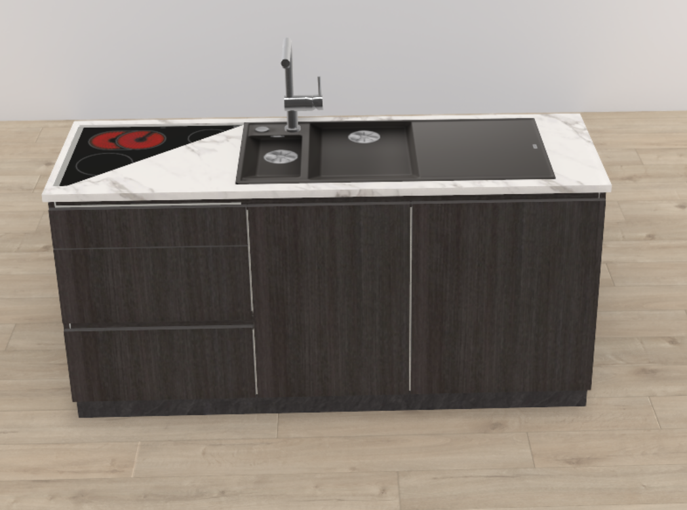

# Open issues of the libraries

> **Type**: Backlog — what the library data lacks for the agent to plan right
> **Domain**: the library data the plan context passes on — the article list and the master data,
> and in them the `desc` properties
> **Maintained by**: step 7 of [the testing skill](../skills/hi-mcp-testing.md#7-open-issues)

The MCP server is library-neutral ([§2.4](../../docs/hi-mcp-behaviour.md#24-instructions)): what
the agent knows of a library comes only from the library data. When the agent plans wrong because
that data lacks information, the fix is in the library, and the issue is here. What a library builds
is intended; an issue asks for information, not for other geometry. Each issue names the library,
the problem, its cause, how the library behaves, the to-do for the library, the test, whether it is
reported to the library development team, and how to reproduce it. MCP, chat and planner issues are
tracked in [mcp-issues.md](mcp-issues.md). The **Status** of an issue says what the library already
carries of it; the issue leaves this document when the library carries all of it. The description
texts proposed to the library are in
[`suggested-library-changes.md`](../../docs/library-information/suggested-library-changes.md), which
keeps every suggested text, applied in the library or not.

## What reaches the agent

- **Article descriptions** are written in sections — `FUNCTION`, `PURPOSE`, `TYPICAL_PLACEMENT`,
  `REQUIREMENTS`, `RECOMMENDED_NEIGHBOURS`, `RESTRICTIONS`, `STYLE_COMPATIBILITY`, `SEARCH_KEYWORDS`,
  `AI_SELECTION_HINT` — and hold at most 1000 characters. The catalog of `get-plan-context` serves
  the `FUNCTION` and `AI_SELECTION_HINT` lines only (D63 of
  [`docs/hi-mcp-behaviour.md`](../../docs/hi-mcp-behaviour.md)); the full description only when the
  agent requests `articleDescriptions`. What the agent needs to pick an article goes into these two
  lines.
- **The attribute vocabulary** of `get-plan-context` serves the customer-facing attributes —
  `isMain`, or `userRight` `Simple` — with the `desc` of the attribute and the name and `desc` of each
  value, in full (D76). A value list several attributes share is listed once.
- **Any other attribute** reaches the agent only when the library changes its value and the result
  names the change (D59) — `mod_CarcaseProgram`, `mod_CarcaseOutsideProgram` and
  `mod_FingergripType`, for example. A rule the agent needs goes into a customer-facing attribute.

## Overview

| # | Issue | Library | Responsible | Status | Solved by descriptions | Priority |
|---|---|---|---|---|---|---|
| 60 | [The sink top of a sink unit reaches past the row or over the hob](#60-the-sink-top-of-a-sink-unit-reaches-past-the-row-or-over-the-hob) | HOMAG Furniture_Smith | HOMAG library development team | the sink unit and sink value descs done; the basin-right sinks and the sink widths to confirm | yes | medium — the drainer in the air or over the hob |
| 61 | [Handleless fronts done with a handle attribute](#61-handleless-fronts-done-with-a-handle-attribute) | HOMAG Furniture_Smith | HOMAG library development team | the handle design descs done | yes | medium — handled articles where the user asked for handleless ones |
| 64 | [Flip-lift wall cabinets with sizes the library cannot calculate](#64-flip-lift-wall-cabinets-with-sizes-the-library-cannot-calculate) | HOMAG Furniture_Smith | HOMAG library development team | the flap cabinet descs done; the size ranges not reported | yes | low — the cabinets are not built, the agent needs a second create |
| 69 | [End panels with a plain upright colour the library cannot calculate](#69-end-panels-with-a-plain-upright-colour-the-library-cannot-calculate) | HOMAG Furniture_Smith | HOMAG library development team | the upright descs done; the colour value descs not done | yes | low — the end panels are not built, the agent needs one or two extra calls |
| 70 | [Carcase side panels with a plain outside colour the library cannot calculate](#70-carcase-side-panels-with-a-plain-outside-colour-the-library-cannot-calculate) | HOMAG Furniture_Smith | HOMAG library development team | the carcase colour descs done; the colour value descs and the outside program not done | partly | low — the end units are not built, the agent needs three extra calls and loses the wood carcase |
| 71 | [Folding-flap wall cabinets with glass fronts the library cannot calculate](#71-folding-flap-wall-cabinets-with-glass-fronts-the-library-cannot-calculate) | HOMAG Furniture_Smith | HOMAG library development team | the flap cabinet and front program descs done; the colour value descs not done | partly | low — the cabinets are not built, the agent needs two attribute changes and loses the glass fronts |
| 76 | [Articles with two doors that do not say how their doors stand](#76-articles-with-two-doors-that-do-not-say-how-their-doors-stand) | HOMAG Furniture_Smith | HOMAG library development team | the article and attribute descs done; `LeftLeft` and `RightRight` not reported | yes | low — two doors one above the other taken for a pair are not built, the agent needs a second call |

**Solved by descriptions**: with the descriptions the agent builds at the first attempt what it
wants, without a call the library cannot calculate; "partly" names in the issue what only the
library's logic or data can do.

`run.json` and `planner-calls.json` of the run directories named under **Reproduce** hold the payload
the model sent; the directories are under `.temp/result/`.

## 60. The sink top of a sink unit reaches past the row or over the hob

**Problem.** The sink unit `SUT60` carries a sink with its drainer, 980 mm wide, on the 600 mm unit.
Placed as the last unit of a row, the drainer reaches 396 mm past the end of the row, into the air;
swapped beside the hob unit, it covers part of the hob. Whether the agent puts a base unit under the
drainer is chance.

**Cause.** The geometry is intended (the library builds the sink that way); the root module's
outline in `obstacles` shows it, and the descriptions of the sink units name it. Every sink unit
comes with the sink `mod_SinkId` `Axia_Grey_L`, whose value desc is its code: nothing in the
attribute vocabulary says on which side its drainer is.

**How the library behaves.** All five sink units come with `mod_SinkId` `Axia_Grey_L` (Blanco),
basin on the left, drainer on the right, 980 mm wide with the drainer. The outlines of the root
modules in the plan contexts of the stored runs overlap the root module at the next `rowIndex`, the
unit on the right:

| Articles | Unit width | Outline along the row | Reaches past the right side |
|---|---|---|---|
| `SUT60`, `SUBA60`, `ESUT60` | 600 mm | 995.75 mm | 396 mm |
| `SUB2A90`, `ESUB2A90` | 900 mm | 1145.75 mm | 246 mm |

**To do.** The library: the value descs of `mod_SinkId` name the basin side and the drainer side —
section 2.8 of
[`suggested-library-changes.md`](../../docs/library-information/suggested-library-changes.md#28-sink).
The library team confirms the drainer side of the basin-right sinks, whether the sink units take
them — the drainer then reaches over the unit on the left, and the sink unit descriptions name the
side by the sink —, and the widths of the Axis, Dinas and Metra sinks. Then check that the served
text needs nothing more.

**Status.** Done in the library: the descriptions of `SUT60`, `SUBA60`, `SUB2A90`, `ESUT60` and
`ESUB2A90` (section 1.1) — the width of the sink with its drainer, how far it reaches past the
right side, a base unit and not a hob unit on the right — and the value descs of `mod_SinkId`
(section 2.8). Open: the library team confirms the basin-right sinks and the widths of the Axis,
Dinas and Metra sinks.

**Example.** The sink unit beside the hob unit: the sink top covers part of the hob.

- [The plan in the HI presets example](https://rubens.alpha.roomle.com/examples/index.html?example=hi-presets-example&backendId=HI_PRE_Roomle_Milestone_2&library_id=Furniture_Smith&plan_id=ps_rcc154z2tb6cs0yl4sq2g3f38rh13tfb)
- [The order in the HOMAG order manager](https://ordermanager-preview.homag.cloud/#/e2fe8b3d-da31-4a20-92ab-ab6e3839300e/orders/dad09fbf-7dca-41c6-b0bb-d101c1befec6)

**Test.** The test `image-kitchen-left-wall` of `docs/test-prompts.json`: the sink unit stands with a
base unit under its drainer in three runs of gpt-6-astra; `edit-swap-hob-unit`: the drainer does not
cover the hob, and the agent identifies a swap that would put the hob immediately to the right of
the sink as conflicting with the library's selection rule.

**Reproduce.** `mcp-test-2026-10-17_13-28-41`: gpt-6-astra 30 (`edit-swap-hob-unit`): the swapped sink's top reaches 396 mm over the hob unit on its right; the sink descs carry the base unit on the right, not the hob rule.

## 61. Handleless fronts done with a handle attribute

**Problem.** For "only handleless fronts" the agent keeps the handled articles and sets
`mod_HandleDesign` to the value without a handle, where the test expects the handleless articles of
the catalog (category `Kitchen handleless`).

**Cause.** The handleless articles say what they are: their descs start with "Handleless …
(fingergrip)" and select them for handleless fronts. The handle design value without a handle
(`mod_HandleDesign` 10, `master-data.json:4158`) has the desc "No handle" only, so nothing tells
the agent that setting it on a handled article is not the same as choosing a handleless article.

**How the library behaves.** The handleless articles come with `mod_HandleDesign` `10`,
`mod_FingergripType` `Wood` and `mod_CreateFingergrip` `True` (`article.json`): fronts with a wooden
fingergrip. A handled article set to `mod_HandleDesign` `10` keeps `mod_CreateFingergrip` `False`
and `mod_FingergripType` `None`: fronts without a handle and without a grip (order data of
`mcp-test-2026-10-17_13-28-41` gpt-6-astra 52). The two fingergrip attributes are not in the
attribute vocabulary (`userRight` `Advanced`). The catalog has handleless variants of base units
only — sink, storage, corner and hob units. In `mcp-test-2026-10-16_19-30-19` gpt-6.1-sol 50, turn 5,
the model answers "No fingergrip profiles were added—the existing units do not support that
attribute".

**To do.** The library: the descs of `mod_HandleDesign` and its value `10` — section 2.5 of
[`suggested-library-changes.md`](../../docs/library-information/suggested-library-changes.md#25-handle-design).
Then check that the served text needs nothing more.

**Status.** Done in the library: the descs of `mod_HandleDesign` and its value `10` (section 2.5).

**Test.** The test `kitchen-conversation` turn 5 ends with handleless articles.

**Reproduce.** `mcp-test-2026-10-17_13-28-41`: gpt-6-astra 52 (`kitchen-conversation`, turn 5): `mod_HandleDesign` 10 on the handled articles of both groups.

## 64. Flip-lift wall cabinets with sizes the library cannot calculate

**Problem.** To copy the band of cabinets above the tall units of a photo, the agent puts flip-lift
wall cabinets (`OSKB90`) on top of the tall units with `mod_Height` 360 and `mod_Depth` 561. The
library cannot calculate them — "Error 14023: Could not find entry in tab_FlipliftSettings for input
value: SHF - 324 - 862 - 533 - Handle" — so they are not built; the server builds the rest of the
group and names them in `notLoaded`. The agent replaces them with `O2TB90` of the same height and
depth, at the cost of two `exchange-root-module` calls.

**Cause.** The flap fitting takes a limited range of heights and depths. The descriptions of the
flap wall cabinets send the agent to a wall cabinet with doors for any height or depth other than
their own; they name no range, and neither do `mod_Height` and `mod_Depth`.

**How the library behaves.**

| Article | `mod_Height` × `mod_Depth` | Built | Runs |
|---|---|---|---|
| `OSKB60`, `OSKB90`, `OFKB60`, `OFKB90` | 720 × 350, as they come | yes | every run that plans them in their own size |
| `OSKB90` | 360 × 561 | no: "… SHF - 324 - 862 - 533 - Handle" | `mcp-test-2026-10-16_19-30-19` gpt-6.1-sol 48, `mcp-test-2026-10-17_13-28-41` gpt-6-astra 50 |
| `OSKB90` | 300 × 561 | no: "… SHF - 264 - 862 - 533 - Handle" | `mcp-test-2026-10-17_09-31-13` gpt-6-astra 48 |
| `O2TB90` (doors) | 360 × 561 | yes | `mcp-test-2026-10-17_13-28-41` gpt-6-astra 50, the `exchange-root-module` |

Both failing sizes change the height and the depth; which of the two the fitting does not take is
not known.

**To do.** The library: the size ranges of the flap fittings in `tab_FlipliftSettings`, per fitting
and width; with them the `FUNCTION` lines of the flap wall cabinets can name the sizes the flap
takes. Then check that the served text needs nothing more.

**Status.** Done in the library: the `AI_SELECTION_HINT` of `OSKB60`, `OSKB90`, `OFKB60` and
`OFKB90` — a flap cabinet at the height and depth it comes with, a wall cabinet with doors for glass
fronts or another height or depth (section 1.3 of
[`suggested-library-changes.md`](../../docs/library-information/suggested-library-changes.md#13-flap-wall-cabinets)).
Open, not reported: the size ranges.

**Test.** `image-planning-right-wall`: the first create builds the cabinets above the tall units.

**Reproduce.** `mcp-test-2026-10-17_13-28-41`: gpt-6-astra 50 (`image-planning-right-wall`, the `create-or-replace-groups`): two flip-lift wall cabinets `OSKB90` with `mod_Height` 360 not calculated, Error 14023 (`tab_FlipliftSettings`); the model exchanged them for `O2TB90`.

## 69. End panels with a plain upright colour the library cannot calculate

**Problem.** A create whose group attributes set a plain `mod_UprightColor` (Snow white 192, Sunny
white 190) without `mod_UprightProgram` does not build its end and cover panels `W60H`, `W60U` and
`W35O`: "Error 14034: Could not find entry in tab_GrainDirectionSettings for input values:
part_FinishPanel - Upright - Horizontal - NoGrain - 584 - 870" (`W35O`: `- 373 - 720`); the server
builds the rest of the group and names them in `notLoaded`. The agent sets `mod_UprightProgram`
Classic on the end panels with `change-module-attribute`, or undoes the create and sends it again
with that program or without the end panels — one or two extra calls. With `mod_UprightProgram`
Classic, with a wood upright colour and its program, or without an upright colour the end panels
load.

**Cause.** The end panels keep their wood upright program ("Horizontal": `ModernNature`, "Carcase
in wooden colors horizontal") when the group attributes give them a plain colour, for which the
library has no grain direction. The library switches `mod_FrontProgram` itself when a front colour
of the other kind is set (the server reports it as a correction, D59), but not `mod_UprightProgram`;
the descs of the `mod_UprightColor` values name the colour only, not the program it needs. Only the
program's own desc ("Classic carcase in single colors") hints at it.

**How the library behaves.** The colour values are of three kinds. In the stored runs the library
switched the front program to Classic for 160 and 178, to Nature for 222 and 229, to Modern for 326,
and the carcase program to ModernNature for 215, 230, 240 and 326; the stone decors 316, 324, 326 and
380 come as fronts only with Modern (D59). The calculation errors call a plain colour `NoGrain`, a
wood or stone decor `Grain`. The value numbers follow the kinds: 1xx plain, 2xx wood, 3xx stone. The
end and cover panels come with the program ModernNature:

| `mod_UprightColor` | `mod_UprightProgram` | Built | Runs |
|---|---|---|---|
| plain (192, 190) | not set | no | `mcp-test-2026-10-16_19-30-19` gpt-6.1-sol 50 (`W60U`, `W60H`, `W35O`); `mcp-test-2026-10-17_13-28-41` gpt-6-astra 52 and 53 |
| plain (192) | Classic | yes | `mcp-test-2026-10-17_13-28-41` gpt-6-astra 52, the second create of turn 1 |
| wood (222) | Nature | yes | `mcp-test-2026-10-17_13-28-41` gpt-6-astra 52 turn 4; `mcp-test-2026-10-17_09-31-13` gpt-6-astra 50 turn 4 |
| wood (240) | Classic | yes | `mcp-test-2026-10-17_13-28-41` gpt-6-astra 52 turn 7 |

**To do.** The library: the colour value descs name their kind, and the descs of `mod_UprightColor`
and `mod_UprightProgram` name the program for each kind — sections 2.1 and 2.4 of
[`suggested-library-changes.md`](../../docs/library-information/suggested-library-changes.md#21-colour-values).
The colour code stays first in each value desc: `materials.md` reads it from there. The library team
confirms the kind of the values the runs did not show, and whether Nature takes stone decors.
Optional: the library switches `mod_UprightProgram` with `mod_UprightColor`, as the front program
with the front colour; the agent then needs no second attribute, and the desc of `mod_UprightColor`
keeps its first sentence. Then check that the served text needs nothing more.

**Status.** Done in the library: the descs of `mod_UprightColor`, `mod_UprightProgram` and its values
(section 2.4). Open: the kind in the colour value descs (section 2.1); the program values of
`mod_CarcaseProgram` and `mod_CarcaseOutsideProgram` keep their old descs.

**Test.** `kitchen-conversation` turn 1 and `image-kitchen-back-right-corner`: the first create with
a plain upright colour builds its end panels.

**Reproduce.** `mcp-test-2026-10-17_13-28-41`: gpt-6-astra 53 (`kitchen-family-two-kids`, the `create-or-replace-groups`): `mod_UprightColor` 190 without `mod_UprightProgram`, the end panels `W60U` and `W60H` not calculated, Error 14034; the model set `mod_UprightProgram` Classic.

## 70. Carcase side panels with a plain outside colour the library cannot calculate

**Problem.** A create whose group attributes set a plain front colour (Olive green 160) and a wood
carcase colour (`mod_CarcaseColor` Maple 230, then Walnut 215) does not build the units whose side
panel is visible — the tall unit at the end of the row and the base units at both ends: "Error
14034: Could not find entry in tab_GrainDirectionSettings for input values: part_Sidepanelleft -
TallUnitAppliance - Horizontal - NoGrain - 2100 - 561" (`part_Sidepanelright - BaseUnit` alike); the
server builds the rest of the group and names them in `notLoaded`. A change of the carcase colour and
a second create fail alike; only `mod_CarcaseProgram` Classic with a plain carcase colour builds
them — three extra calls, and the carcase is no longer the wood colour the agent chose.

**Cause.** With the wood carcase colour the library switches `mod_CarcaseProgram` itself to
`ModernNature` ("Carcase in wooden colors horizontal"; the server reports it as a correction, D59),
while the outside carcase colour of the units follows the plain front colour (`mod_CarcaseOutsideColor`
160 in the order data). A visible side panel then has a plain colour under a wood program, for which
the library has no grain direction — as the end panels of issue 69. The descs of `mod_CarcaseColor`,
`mod_CarcaseOutsideColor` and `mod_CarcaseProgram` do not say which colour the visible sides take or
which program a plain outside colour needs; `mod_CarcaseProgram` and `mod_CarcaseOutsideProgram`
are not in the attribute vocabulary (`userRight` `Master`, not `isMain`).

**How the library behaves.** A visible side — at the end of a row — takes `mod_CarcaseOutsideColor`;
where the create does not set it, it is the front colour (order data of
`mcp-test-2026-10-16_19-30-19` gpt-6.1-sol 46: `mod_CarcaseOutsideColor` 160, the front colour). A
wood or stone `mod_CarcaseColor` switches `mod_CarcaseProgram` to ModernNature, and the visible sides
are built with it. The same error hits base, wall and tall units:

| Front | `mod_CarcaseColor` | `mod_CarcaseOutsideColor` | Visible sides built | Runs |
|---|---|---|---|---|
| plain (160, 192) | wood (230, 215, 229) | not set: the front colour | no | `mcp-test-2026-10-16_19-30-19` gpt-6.1-sol 46 (`HK260`, `USTB60`, `UTB60`); `mcp-test-2026-10-17_10-50-12` mistral-large-latest 50 (base, wall and tall units) |
| plain (160) | wood (224, 215) | the same wood | yes | `mcp-test-2026-10-17_09-31-13` gpt-6-astra 46; `mcp-test-2026-10-17_13-28-41` gpt-6-astra 48 |
| wood (229, 240) | plain (178, 190) | the front wood | yes | `mcp-test-2026-10-16_19-30-19` gpt-6.1-sol 45; `mcp-test-2026-10-17_09-31-13` gpt-6-astra 45 |

**To do.** The library: the colour value descs name their kind, and the descs of `mod_CarcaseColor`
and `mod_CarcaseOutsideColor` say that the visible sides take the outside colour and which kind it
needs with a wood or stone carcase — sections 2.1 and 2.3 of
[`suggested-library-changes.md`](../../docs/library-information/suggested-library-changes.md#23-carcase-colours).
With them the agent builds the units at the first attempt, the visible sides in a wood or stone
decor. Plain visible sides on a wood or stone carcase need the library: it switches
`mod_CarcaseOutsideProgram` with `mod_CarcaseOutsideColor`, as the front program with the front
colour; the desc of `mod_CarcaseColor` then keeps its first two sentences. The library team confirms
whether `mod_CarcaseOutsideProgram` Classic builds such sides today. Then check that the served text
needs nothing more.

**Status.** Done in the library: the descs of `mod_CarcaseColor` and `mod_CarcaseOutsideColor`
(section 2.3). Open: the kind in the colour value descs (section 2.1), and the switch of
`mod_CarcaseOutsideProgram` with `mod_CarcaseOutsideColor`.

**Test.** `image-kitchen-left-wall`: the first create with green fronts and a wood carcase builds
every root module.

**Reproduce.** `mcp-test-2026-10-16_19-30-19`: gpt-6.1-sol 46 (`image-kitchen-left-wall`, the first `create-or-replace-groups`): `mod_FrontColor` 160 and `mod_CarcaseColor` 230 in the group attributes, `HK260`, `USTB60` and `UTB60` not calculated, Error 14034; the `change-group-attribute` with `mod_CarcaseProgram` Classic and `mod_CarcaseColor` 192 builds them.

## 71. Folding-flap wall cabinets with glass fronts the library cannot calculate

**Problem.** To copy the glass wall cabinets of a photo, the agent gives two folding-flap wall
cabinets (`OFKB60`) the front program Modern ("Mitred frame fronts with glass filling"). The library
cannot calculate them — "Error 14036: Could not find entry in tab_PanelWoodFrameConstruction for
input values: Fliplift - ModernFrame01 - Grain - Grain - None" — and sets their front colour to
Concrete; the server builds the rest of the group and names them in `notLoaded`. The agent sets the
program Classic and the colour back, two `change-module-attribute` calls, and the glass fronts of the
photo are plain. A stone decor as front colour leads there too: it comes only with Modern, and the
library switches the program. Drawers and pull-outs with Modern fail alike: "Drawer - ModernFrame01 -
NoGrain - NoGrain - Glass".

**Cause.** The library builds Modern on doors only, and the library data does not say so: the desc
of the program Modern names a mitred frame with glass, the stone decors name their colour only. The
kitchen catalog has no wall cabinet with glass fronts; the glass display cabinets `SM_WT300S` and
`SM_HT600S` are living-room articles.

**How the library behaves.**

| Fronts with Modern | Built | Runs |
|---|---|---|
| doors (`OTB60`) | yes; the library sets Concrete 316 in place of Sunny white 190 | `mcp-test-2026-10-17_13-28-41` gpt-6-astra 51 |
| flaps (`OFKB60`), Modern set | no | `mcp-test-2026-10-16_19-30-19` gpt-6.1-sol 49 |
| flaps (`OSKB60`, `OSKB90`), Slate 326 set as front colour, the library switched to Modern | no | `mcp-test-2026-10-17_10-50-12` mistral-large-latest 48 |
| drawers and pull-outs (`US2A60`, `UKS2A60`, `HTS2AB60`) | no; the doors of the same calls are built | `mcp-test-2026-10-17_10-50-12` mistral-large-latest 50, attempt 1, turn 5 |

**To do.** The library: the desc of Modern says that it builds doors in stone decors, and the stone
decors that a front in them is a Modern door — sections 2.1 and 2.2 of
[`suggested-library-changes.md`](../../docs/library-information/suggested-library-changes.md#22-front-program).
With them the agent builds glass wall cabinets with doors. Glass flaps and glass drawer fronts need
the library, if it wants to offer them: entries for `Fliplift` and `Drawer` with `ModernFrame01` in
`tab_PanelWoodFrameConstruction`. Then check that the served text needs nothing more.

**Status.** Done in the library: the `AI_SELECTION_HINT` of the flap wall cabinets sends the agent to
a wall cabinet with doors for glass fronts (section 1.3), and the desc of Modern (section 2.2).
Open: the stone decors in the colour value descs (section 2.1); glass flaps and glass drawer fronts,
if the library wants to offer them.

**Test.** `image-only-no-text`: the create builds the glass wall cabinets of the photo, or picks
articles that take the glass front.

**Reproduce.** `mcp-test-2026-10-16_19-30-19`: gpt-6.1-sol 49 (`image-only-no-text`, the `create-or-replace-groups`): two `OFKB60` with `mod_FrontProgram` Modern not calculated, Error 14036, in one `notLoaded` error.

## 76. Articles with two doors that do not say how their doors stand

**Problem.** In a row, the agent hinges the doors at the two ends at the outer sides of the row
([D84](../../docs/hi-mcp-behaviour.md#doors-2026-10-17)), with the value of
`mod_DoorDirectionSelection` for single doors or for a pair of doors. A value the article does not
take fails with error 14019 and the root module is not built: `H2TB60` with `LeftRight`, `U2TB90`
with `Left` or `Right`. `LeftLeft` and `RightRight` are offered for a pair but not calculated on
`U2TB90`.

**Cause.** `tab_DoorSettings` has no entry for `LeftLeft` and `RightRight` on `U2TB90`. The desc of
the handle position type `14` names "the place of 03" instead of `13`.

**How the library behaves.** Checked on the bo-test planner on 2026-10-17, without a model, through
the MCP tools:

| Articles | Doors | `Automatic` resolves to | Calculated | Not calculated (Error 14019) |
|---|---|---|---|---|
| `KS_HT600K`, `HEST60`, `HEMT60`, `HEET60`, `UTB60`, `SB_UB600` | one door | `Left` | `Left`, `Right` (set on `KS_HT600K` and `SB_UB600`) | not checked |
| `H2TB60` | two doors, one above the other | `Left` on both | `Right` on both | `LeftRight` |
| `U2TB90` | a pair of doors side by side | `LeftRight` | `LeftRight` | `Left`, `Right`, `LeftLeft`, `RightRight` |

By their door modules in the article list, `H2TB60` and `HWR_HB600T2` have two `mf_Door` on 60 cm,
one above the other; `U2TB90`, `O2TB90`, `US2TB90` and `EU2TB90` one `mf_Door` on 90 cm, a pair.
`mod_HandlePosType` on a single door of `KS_HT600K`, hinged left and hinged right: `03` and `04` both
put a vertical handle at the edge opposite the hinge, at the same place, turned by 180° against each
other; `05` and `06` put it in the middle of the door's width. None changes the hinge side.

**To do.** The library: `LeftLeft` and `RightRight` are calculated on the articles with a pair of
doors, or their descs name the articles that take them; the desc of `14` names the place of `13` —
section 2.7 of
[`suggested-library-changes.md`](../../docs/library-information/suggested-library-changes.md#27-handle-position-type).
Then check that the served text needs nothing more.

**Status.** Done in the library: the `FUNCTION` lines of the articles with two doors say "2 doors one
above the other" or "a pair of doors side by side" (section 1.2), and the descs of
`mod_DoorDirectionSelection` and `mod_HandlePosType` and their values, `14` with the place of `13`
(sections 2.6 and 2.7). Open, not reported to the library development team: `LeftLeft` and
`RightRight`.

**Test.** `wardrobe-door-hinges` and `wardrobe-extend-door-hinge`: the doors at the ends of the row
hinged at the outer sides, with values the library calculates.

**Reproduce.** The planner probe of [RML-18203](https://roomle.atlassian.net/browse/RML-18203), without a model, on the bo-test planner: `create-or-replace-groups` with `U2TB90` and `mod_DoorDirectionSelection` `Left`, `Right`, `LeftLeft` or `RightRight`, or `H2TB60` with `LeftRight` — error 14019 in `notLoaded`.
