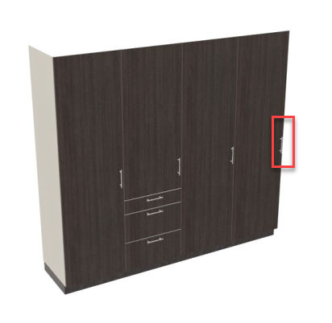
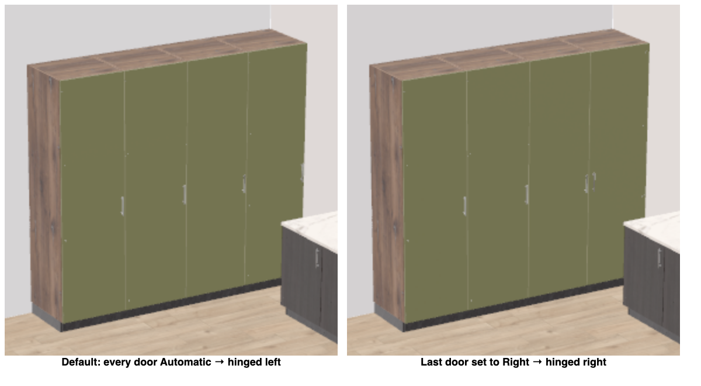

# Bug analysis — the door at the right end of a row is hinged on the left

> **Type**: Bug analysis
> **Status**: Open
> **Ticket**: [RML-18203](https://roomle.atlassian.net/browse/RML-18203)
> **Date**: 2026-10-17
> **Base**: `master` 5af8174; the planner of the probe: roomle-ui `release/bo-test` b2dbcb202

## Affected repositories

- **roomle-hi-example** — the served rules of the MCP server: the front rule of `AUTHORING_RULES`
  (`hi-mcp/hi-mcp-server/hi-mcp-server.ts:19`) and its unit test, `docs/hi-mcp-behaviour.md`, two
  test prompts in `docs/test-prompts.json`, a library issue in `.agents/backlog/library-issues.md`.
  This is where the fix belongs.
- **HOMAG library (Furniture_Smith)** — the descs of the attributes `mod_DoorDirectionSelection` and
  `mod_HandlePosType` and of their values lack information. A library issue for the library
  development team, proposed as change 2 of
  [`docs/library-information/suggested-library-changes.md`](../../docs/library-information/suggested-library-changes.md#2-the-door-direction-and-handle-position-descriptions-do-not-say-which-side-a-door-opens-to);
  the library keeps its behaviour.
- **roomle-ui** — no change. The plan context lists the attribute, and the tool commands set it on a
  root module and on its door.
- **ligna-store** — no change. Its chat gets the served text from the MCP server.

## Symptom

Reported with this image:

> If you have multiple cabinets in a row, the door handles should never be on the outside of the
> row. The door of the cabinet on the far left should open to the left, with the handle on the
> right. The door of the cabinet on the far right should open to the right, with the handle on the
> left. This issue can usually be resolved by changing the opening direction of the door for
> individual cabinets.

The door on the far right has its handle at the outer edge of the row (red frame).

## Reproduction

Without a model, through the MCP tools on the deployed bo-test planner: the example launcher on
spare ports (`EXAMPLE_PORT=3001 HI_MCP_PORT=3110 node minimal-hi-example/start.mjs --no-open`), the
page in headless Chromium, the MCP SDK client. One `create-or-replace-groups` call with three groups,
each placed by wall, each root `rightOf` the one before, no attributes:

| Group | Articles | `mod_DoorDirectionSelection` of the root and the door | `mod_DoorDirection` of `mf_Door` |
|---|---|---|---|
| closed wardrobe | `KS_HT600K` ×4 | `Automatic` | `Left` on every door |
| endless wardrobe | `HEST60`, `HEMT60`, `HEMT60`, `HEET60` | `Automatic` | `Left` on every door |
| base units | `UTB60` ×3 | `Automatic` | `Left` on every door |

Then the two ways the agent can set the side:

- `change-module-attribute` with `rootModuleIds` the right end of the closed wardrobe,
  `attributeId` `mod_DoorDirectionSelection`, `value` `Right`: `changedModuleIds` names the root
  module and `mf_Door`, the door's `mod_DoorDirection` is `Right`, its handle moves to its left edge.
- `create-or-replace-groups` with four sideboards `SB_UB600`, the first root with the attributes
  `mod_DoorDirectionSelection` `Left`, the last with `Right`: the doors are `Left`, `Left`, `Left`,
  `Right`; no corrections.

Left: the closed wardrobe as created — every door hinged left, the handle of the right end on the
outside. Right: after `change-module-attribute` with `Right` on the right end — its handle beside its
neighbour's.

Articles with two doors, and the handle position, in a second probe of the same kind:

- `U2TB90`, a pair of doors side by side: `Automatic` resolves to `LeftRight`, the handles meet in
  the middle of the cabinet, and `LeftRight` is calculated. `Left`, `Right`, `LeftLeft` and
  `RightRight` fail with "Error 14019: Could not find entry in tab_DoorSettings", and the root module
  is not built.
- `H2TB60`, two doors one above the other: `Automatic` resolves to `Left` on both doors, `Right`
  hinges both on the right, `LeftRight` fails with error 14019.
- `mod_HandlePosType` on `KS_HT600K`, hinged left and hinged right: `03` and `04` put the vertical
  handle at the edge opposite the hinge, at the same place, the handle turned by 180° against each
  other; `05` and `06` put it in the middle of the door's width. None changes the hinge side, though
  "Door vertical rotation right" reads like one.

## Investigation trace

### What the library does

- `mod_DoorDirectionSelection` (`docs/library-information/master-data.json:8409`): name "Door
  direction", desc "Direction of the door", group `Front | Construction`, `isMain` true,
  `userRight` `Simple`, `implicitRelevant` false. Its values: `Left` "Door left hinged", `Right`
  "Door right hinged", `LeftRight`, `LeftLeft`, `RightRight` for two doors, `Automatic` "Setting via
  tab_DoorSettings".
- The root modules `mr_StorageunitSingle` and `mr_CornerunitStraight` carry it, and the front
  modules `mf_Door`, `mf_Fridge`, `mf_FillerFront` and `mf_BaseunitFridge`.
- One article of the article list sets it, `KS_HT600`, to `Automatic`; every other article gets the
  same value from the library.
- The library resolves `Automatic` of a single door to `mod_DoorDirection` `Left` — hinged on the
  left, the handle on the right — whatever the door's place in the row. `mod_DoorDirection` is
  internal: the master data does not list it. The END article of the endless wardrobe, `HEET60`, is
  hinged left too.
- `implicitRelevant` false: the door direction is not passed on between neighbours (D56). A root
  module that an edit adds to a row gets `Automatic`, so `Left`.

So by default the door at the left end of a row is as the rule wants it, hinged on the left, and
the door at the right end of every row has its handle on the outside.

### What the agent sees

- The attribute vocabulary of `get-plan-context` lists `mod_DoorDirectionSelection` with its six
  values: a root module carries it and it is customer-facing (`isCustomerFacingAttribute`, roomle-ui
  `homag-intelligence/src/hi-plan-context.ts:250`). `find-attributes` finds it by "door" or
  "hinged".
- A root of `groups` lists its input attributes only (`shapeRoot`, `hi-plan-context.ts:690`, the
  filter at :699): the door direction appears once it is set; `Automatic` and the side it resolves to
  are not shown, and the sub modules come without attributes. `rowIndex` names the place of a root
  module in its row, 1 at the left end as seen from the front (D66), so the agent knows the two ends.
- `get-plan-images` shows the handles.

### What the agent can do

- `create-or-replace-groups`: the `attributes` of a root are overrides of that root module
  (`hi-mcp-server.ts:17`), and the library passes the root module's value on to its door.
- `change-module-attribute`: sets the attribute on the root module and on every sub module that
  carries it (D54; `_attributeTargets`, roomle-ui `homag-intelligence/src/hi-tools.ts:1113`).

Both work, as the reproduction shows.

### What the served text says

- The front rule of `AUTHORING_RULES` (`hi-mcp-server.ts:19`) speaks of the front program and the
  front colour only. Nothing says on which side a door is hinged.
- The extending rule (`hi-mcp-server.ts:35`) and the descriptions of `merge-article-into-group`,
  `insert-article-into-group` and `exchange-root-module` say that a new root module inherits "fronts,
  handles, carcase" from its neighbour. That holds for the handle design, not for the hinge side,
  and nothing says that a new end of a row needs a side.
- The planning skills: `kitchen-planning/SKILL.md:132` lists "opening direction/extension" among what
  to record per cabinet, with no rule for the side; `image-planning/SKILL.md:42` reads "the handles"
  from an image as attributes of the group — the design, not the side. No skill covers a wardrobe,
  and the skills are maintained as their authors deliver them (D75).

## Root cause

The served rules never tell the agent that the doors at the two ends of a row are hinged at the
outer sides of the row. The front rule of `AUTHORING_RULES` (`hi-mcp/hi-mcp-server/hi-mcp-server.ts:19`)
covers the front program and the front colour only, and no tool description and no planning skill
names the hinge side. So the agent leaves the door direction at the library's `Automatic`, which
hinges every single door on the left: the door at the right end of every row has its handle on the
outside — after a create, and again on every root module an edit adds at the right end.

The library data adds to it. Neither the attribute's desc "Direction of the door" nor the desc of
`Automatic`, "Setting via tab_DoorSettings", tells the agent what it gets when it leaves the value
alone, or which values single doors and a pair of doors take. `mod_HandlePosType` reads like a door
direction and is none. What the library does with `Automatic` is intended.

## Proposed fix

Step 1 of [Guards Are a Last Resort](../../AGENTS.md#guards-are-a-last-resort): clarify the
instructions. No guard and no correction.

### 1. The served rule (roomle-hi-example)

A library-neutral rule for doors beside the front rule of `AUTHORING_RULES` — no attribute id, no
value; the exact text is step 1 of the [implementation plan](#implementation-plan).
`AUTHORING_RULES` reaches every agent: at initialize, and through `get-authoring-rules`, which the
description of `create-or-replace-groups` names, in the chats. A unit test guards it.

### 2. Not proposed: the server sets the side

After a create or an edit, the tool command could set the hinge side of a row's two ends itself, by
`rowIndex`. It would have to know the library's door direction attribute and its values — library
information in the server's logic, against §2.4 of
[`docs/hi-mcp-behaviour.md`](../../docs/hi-mcp-behaviour.md#24-instructions). For the same reason
there is no correction.

### 3. The library issue

The descs of `mod_DoorDirectionSelection` and its values say the hinge side as seen from the front,
that the handle is on the other side, which values single doors and a pair of doors take, and what
`Automatic` chooses; the descs of `mod_HandlePosType` say that it places and turns the handle and
does not change the side a door opens to. The exact text is change 2 of
[`docs/library-information/suggested-library-changes.md`](../../docs/library-information/suggested-library-changes.md#2-the-door-direction-and-handle-position-descriptions-do-not-say-which-side-a-door-opens-to),
tracked as a new item of [`.agents/backlog/library-issues.md`](../backlog/library-issues.md), not
reported yet. The served rule works without it: the agent sets both ends.

### 4. Documentation and tests

- `docs/hi-mcp-behaviour.md`: the fronts bullet of §5.2 and a decision row (the doors at the ends of
  a row are hinged at the outer sides; the agent sets it).
- `.agents/skills/hi-authoring-rules.md`: its **Fronts** paragraph.
- `docs/test-prompts.json`, on the plan `closets`: a wardrobe of four single-door cabinets on the
  back wall — the left end hinged left, the right end right; a cabinet added at the right end of a
  row — the new end hinged right.

## Decisions

Gernot Steinegger, 2026-10-17:

1. **The former end after an extension keeps its side.** After a cabinet is added at the right end,
   the former end keeps `Right`, its handle beside its left neighbour's. The rule names the ends
   only; the agent does not set the former end back.
2. **A row with a corner article: its two free ends are the ends of the row.** The corner article
   stands inside the row. This is how `rowIndex` counts already — a corner article joins the two
   legs into one row (D66) —, so the ends are the root modules with `rowIndex` 1 and the last one,
   and the rule needs no words of its own for a corner.

## Implementation plan

Only roomle-hi-example changes; roomle-ui and ligna-store stay as they are. No guard, no correction,
no new tool parameter: the tools already set the side (D54), the agent is told to.

### 1. The served rule

`hi-mcp/hi-mcp-server/hi-mcp-server.ts`: a new bullet **Doors** in `AUTHORING_RULES`, right after
the **Fronts** bullet (line 19). `INSTRUCTIONS` embed `AUTHORING_RULES` (line 83), so the rule
reaches the agent at initialize and through `get-authoring-rules`:

> - Doors: a door is hinged on one side and has its handle on the other. In a row, the door at the
>   left end is hinged on the left and the door at the right end on the right, as seen from the
>   front, so no handle is on the outside of the row; a pair of doors side by side is hinged at its
>   two outer sides. Set it with the attribute whose values say on which side a door is hinged - the
>   value for single doors or for a pair of doors, as the article has - in the attributes of the root
>   modules at the two ends of the row (rowIndex 1 and the last), and again on the root module at an
>   end after an edit that gives the row a new end: an article added, deleted, exchanged or swapped
>   at an end. The other doors keep their side.

Why each part:

- No attribute id, no value: the server is library-neutral (§2.4). Which attribute and which value
  the library data says — today by "Door left hinged" and "Door right hinged", better with change 2
  of the suggested library changes.
- "the value for single doors or for a pair of doors": the library calculates a single-door value
  only on single doors and a pair value only on a pair; any other value fails with error 14019 and
  the root module is not built.
- "rowIndex 1 and the last": decision 2 — a corner article joins the legs into one row (D66).
- "The other doors keep their side": decision 1.
- "an article added, deleted, exchanged or swapped at an end": the door direction is not passed on
  between neighbours (D56). `merge-article-into-group` and `exchange-root-module` take `attributes`,
  so the side goes into the same call; after a delete or a swap the agent calls
  `change-module-attribute`.

The tool descriptions stay as they are.

**Risk.** `H2TB60` says "with 2 doors" for two doors one above the other. An agent that takes them
for a pair sets the pair value, the library cannot calculate it, and the result names the root
module in `notLoaded` with error 14019 and "change the failing values" — the agent recovers with a
second call. The article descs of change 2 remove the doubt.

### 2. The unit test

`hi-mcp/hi-mcp-server/tests/hi-mcp-server.test.ts`, after
`it('tells the agent that the front program says how a front is built and that a colour can switch it')`
(line 865), with the same setup — `connectClient(createMockPlannerApi())`, the rules from
`get-authoring-rules`, the instructions and the tool list:

`it('tells the agent to hinge the doors at the two ends of a row at its outer sides')`

- The rules and the instructions contain "In a row, the door at the left end is hinged on the left
  and the door at the right end on the right, as seen from the front, so no handle is on the outside
  of the row".
- The rules contain "a pair of doors side by side is hinged at its two outer sides", "the root
  modules at the two ends of the row (rowIndex 1 and the last)", "again on the root module at an end
  after an edit that gives the row a new end" and "The other doors keep their side".
- The served text — instructions, rules and tool list — contains neither `mod_DoorDirection` nor
  `mod_HandlePosType`: the rule stays library-neutral.

Checks: `npm test` and `npm run typecheck` in `hi-mcp/`, `npm run lint` and `npm run format:check`
at the root.

### 3. The documentation

- `docs/hi-mcp-behaviour.md` §3: a new subsection **Doors (2026-10-17)** after **Merge
  (2026-10-16)**, with D84 — the doors at the two ends of a row are hinged at its outer sides, and
  the agent sets it with the library's door direction on the root modules at the ends, also after an
  edit that gives the row a new end; the other doors keep their side; the ends are `rowIndex` 1 and
  the last, a corner article inside the row (D66). Rejected: the server sets the side by `rowIndex`,
  or corrects it — library information in the server's logic (§2.4). Source: user, 2026-10-17. State:
  in effect — `AUTHORING_RULES`, guarded by the new test.
- `docs/hi-mcp-behaviour.md` §5.2: a bullet **Doors** (D84) after **Fronts**.
- `.agents/skills/hi-authoring-rules.md`: a **Doors.** paragraph after **Fronts.** (line 13).

### 4. The test prompts

`docs/test-prompts.json`, two tests on the plan `closets`, in user words without tool names
(ADR 0006):

| id | title | prompt | expect |
|---|---|---|---|
| `wardrobe-door-hinges` | Door hinges at the ends of a wardrobe | "add a wardrobe of four cabinets with one door each to the back wall" | one create-or-replace-groups call with a placement by wall (wall back); one group of four single-door wardrobe cabinets in a row; the root module at the left end hinged on the left and the one at the right end hinged on the right, set in their attributes; no handle on the outside of the row |
| `wardrobe-extend-door-hinge` | A new end of a wardrobe | "add a wardrobe of three cabinets with one door each to the back wall", then "add one more cabinet at its right end" | turn 1: as `wardrobe-door-hinges`, with three cabinets; turn 2: one edit that adds a cabinet at the right end of the group; the new end hinged on the right; the former end keeps its side |

The first goes after `closets-two-wardrobes-corner` (single groups), the second among the edits over
two or three turns.

### 5. The library issue

`.agents/backlog/library-issues.md`: item 76, "Door direction descriptions that do not say which
side a door opens to" — problem, cause, the to-do (change 2 of
`docs/library-information/suggested-library-changes.md`), status not reported, test
`wardrobe-door-hinges`, reproduce: the probe of this analysis — and its overview row (HOMAG
Furniture_Smith, HOMAG library development team, medium — a handle on the outside of every row).

### Not part of the change

- No model run: the new test prompts run when "test the mcp" is asked.
- roomle-ui: the tool commands set the attribute on the root module and on its doors (D54), checked
  in the probe.

## Acceptance criteria (from the ticket)

- The served rules say, in library-neutral words, that the doors at the two ends of a row are hinged
  at the outer sides of the row, and how the agent sets it; a unit test guards the sentence.
- Test prompt: a row of four single-door wardrobe cabinets — the left end root module is hinged
  left, the right end root module right.
- Test prompt: a cabinet added at the right end of an existing row — the new end is hinged right.
- The missing information in the descs of the door direction is a library issue in
  `.agents/backlog/library-issues.md`.
