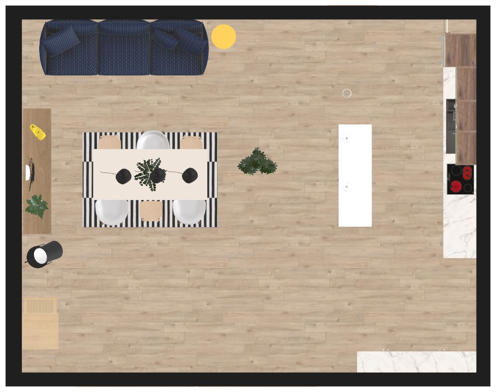
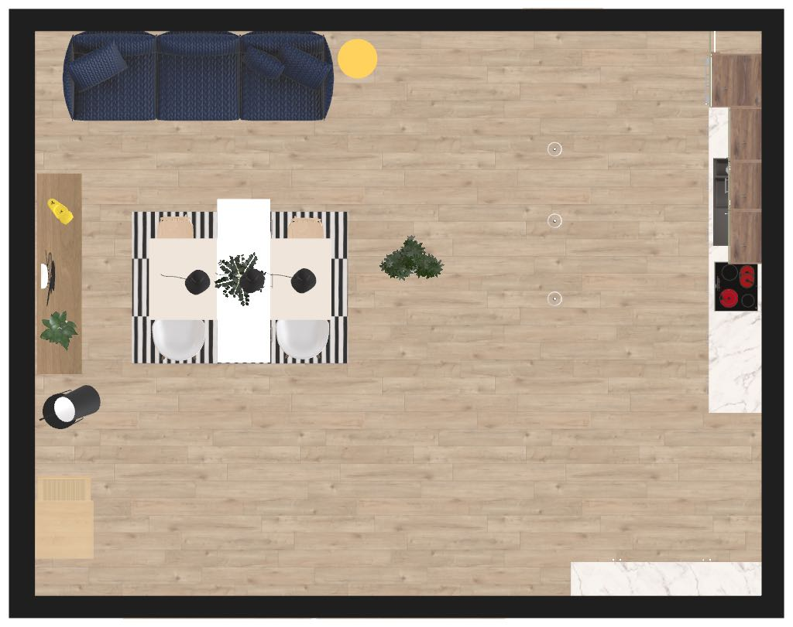

# A group placed over existing objects is not disclosed

> **Type**: Bug analysis
> **Status**: Open
> **Date**: 2026-10-24
> **Base**: roomle-hi-example `master` (`ad749de`); roomle-ui `feat/hi-mcp` (`442aee498`)
> **Backlog**: [mcp-issues.md #90](../backlog/mcp-issues.md#90-a-group-placed-over-existing-objects-is-not-disclosed)

## Affected repositories

- **roomle-ui** (`feat/hi-mcp`) — one unit test in
  `homag-intelligence/__tests__/hi-tool-commands/create-or-replace-groups-placement-test.ts`: a root
  module below an object that hangs above it gets no hint. The test is added to the guards of D55 in
  `.agents/homag-intelligence/hi-tools-behaviour.md`. The tools, the hint and the served text stay
  as they are.
- **roomle-hi-example** — this analysis. The `expect` of `obstacle-island-free-spot` in
  `docs/test-prompts.json` names the pendant lamps above the free spot. The evaluation rule of
  `.agents/skills/hi-mcp-testing.md` says that an object is overlapped only where the heights meet
  too. Backlog item 90 leaves the backlog.
- **ligna-store** — unchanged. No new embedding-lib version is needed.

The roomle-ui paths are relative to `packages/web-sdk/packages/homag-intelligence/`. The D-numbers
are the decisions of
[roomle-ui `hi-tools-behaviour.md`](https://github.com/roomle-dev/roomle-ui/blob/master/.agents/homag-intelligence/hi-tools-behaviour.md).

## Result

The defect does not reproduce. The island of the recorded run stands over no object:

- The two outlines the backlog item calls "a plant" and "a chair" belong to two of three **pendant
  lamps**. The lamps hang from 1950 to 2802 mm above the floor.
- The island's root modules reach 820 mm.
- The hint names an object only where the height range of a root module meets it (D55). It said
  nothing, and the answer ("existing furniture remains unchanged") was right.

The backlog item came from the evaluation of 2026-10-20. That evaluation compared the floor outlines
without the heights, and it named the outlines after the objects that the test's `expect` lists. The
three other recorded runs of the test put the island under the same lamps, and their evaluations
judged it as a pass.

## Symptom (as recorded)

`mcp-test-2026-10-20_06-45-46`, gpt-6-astra 52 (`obstacle-island-free-spot`, local roomle-ui :5173),
from the backlog record:

> the model places a new island of three US2A60 base cabinets (1800 mm) away from the walls,
> opposite the kitchen (x 800..1417, z 4200..6000), over a plant (x 869..1031, z 5220..5380) and a
> chair (x 851.76..1048.24, z 4331.05..4528.95); the answer reports only the aisle […] and never
> names the objects the island stands over.

The run directory is no longer on disk. Its payload is in the backlog record: one
`create-or-replace-groups` with `placement.posGroup` `[800, 0, 6000]` and `posRotationY` 90 (pos
space, the agent frame of that day), three `US2A60` `rightOf` each other.

The prompt is "add a kitchen island of three base cabinets in a free spot of the room" (plan
`open-plan-room`, `ps_qwm5odi6tyflyqwpdcxz1la791ho633`).

## The plan

The objects near the free spot between the dining area and the kitchen, from the `plan.xml` of the
2026-10-22 run and the obstacles of its `plan-context.json` (pos space: `x`, `z` on the floor):

| Object | Catalog item | x | z | Height (mm) |
|---|---|---|---|---|
| pendant lamp 1 — the backlog's "plant" | `brands_15:flos_fuscia1` (type `lighting`) | 869 to 1031 | 5220 to 5380 | 1950 to 2802 |
| pendant lamp 2 — the backlog's "chair" | `brands_15:flos_fuscia1`, turned by 105° | 852 to 1048 | 4331 to 4529 | 1950 to 2802 |
| pendant lamp 3 | `brands_15:flos_fuscia1` | 869 to 1031 | 3550 to 3710 | 1950 to 2802 |
| plant on the floor | `roomle_plants_and_trees:Schefflera_arboricola` | −1095 to −225 | 4484 to 5296 | 0 to 1800 |
| dining table | `brands_2:CPH30` | −3545 to −1545 | 4632 to 5532 | 0 to 740 |
| plant on the dining table | `roomle_plants_and_trees:Zamioculcas_zamiifolia` | −2836 to −2246 | 4772 to 5392 | 740 to 1450 |

The chairs stand around the dining table, at x −1557 and lower. The kitchen's base row starts at x
2622. The obstacles section gives every piece of furniture as `kind` `object`, with its outline,
`bottomMm` and `topMm`. It does not say what the object is.

## The runs

| Run | Model | `posGroup` (pos space), rotation 90 | Island root modules | Lamps above the island | Evaluation |
|---|---|---|---|---|---|
| `mcp-test-2026-10-18_08-45-09` 43 | gpt-6.1-sol | `[950, 0, 6200]` | x 950 to 1567, z 4400 to 6200, 0.5 to 820 mm | 1 and 2 | pass: "overlapping no object and no other group" |
| `mcp-test-2026-10-20_06-45-46` 52 | gpt-6-astra | `[800, 0, 6000]` | x 800 to 1417, z 4200 to 6000 | 1 and 2 | backlog item 90 |
| `mcp-test-2026-10-21_12-49-36` 53 | gpt-6-astra | `[850, 0, 6400]` | x 850 to 1467, z 4600 to 6400, 0.5 to 820 mm | 1 | pass: "only pendant lamps hang above it (from 1950 mm), the island reaches 820 mm" |
| `mcp-test-2026-10-22_19-45-49` 49 | gpt-6-astra | `[850, 0, 5900]` | x 850 to 1467, z 4100 to 5900, 0.5 to 820 mm | 1 and 2 | pass: "the three objects over its footprint are the pendant lamps at 1950 to 2802 mm, above it" |

The models chose the place under the lamps every time: it is the free space between the dining area
and the kitchen.

## Reproduction (model-free)

The payload of the 2026-10-22 run was replayed through `callExternalObjectAgentTool` on the planner
of roomle-ui `feat/hi-mcp` (`442aee498`, an own dev server on :5174). The placement was written in
today's plan space: pos space `[x, 0, z]` is `posGroup` `[x, −z, 0]`, and `posRotationZ` is 90. The
script and the output are in `.temp/result/repro-island-under-pendant-lamps-2026-10-24/`.

| # | Call | Placement | `hint` |
|---|---|---|---|
| 01 | `create-or-replace-groups` | `posGroup` `[800, −6000, 0]`, the island of run 52 under the lamps | none |
| 02 | `undo` | | |
| 03 | `create-or-replace-groups` | `posGroup` `[−2800, −6000, 0]`, the same island over the dining table (control) | names every root module with the rug (0 to 20 mm), the table (0 to 740 mm), the plant on the table (740 to 1450 mm) and two chairs (0 to 789 and 0 to 790 mm), then "The groups were built as sent - move or change them if the user did not ask for them there." |

The control does not name the two pendant lamps over the dining table (1525 to 2800 mm). The
hint tests the heights in both directions.

Two of the three lamps (the small discs) hang over the island, and the third hangs beyond its end.
The plant on the floor stands about 1 m to the left of the island.

## Investigation trace

1. **The plan context** gives every object with its outline and its height range. The served
   Obstacles rule (`src/hi-mcp/hi-mcp-server.ts:38`) says so: "objects (doors, windows, other
   furniture) with kind, outline (floor points [x, y, 0]) and bottomMm to topMm".
2. **The create tests the obstacles after the load.** `create-or-replace-groups` calls
   `obstacleHint` for the groups of the call, with the other groups included
   (`src/hi-tool-commands.ts:754-768`).
3. **An object keeps its height range.** `objectBlockers` builds each object's blocker from its
   outline and `[bottomMm, topMm]` (`src/hi-tool-hints.ts:319-363`).
4. **A root module is tested against a blocker by volume.** `obstacleHint` keeps the blockers for
   which `volumesOverlap(root, blocker, …)` holds (`src/hi-tool-hints.ts:548`). `volumesOverlap`
   requires the height ranges to meet as well as the outlines (`src/hi-plan-space.ts:879-888`). The
   root module's range comes from its calculated parts (`rootVolumesInRoom`,
   `src/hi-plan-space.ts:964`).
5. **This is the decided behaviour.** D55 tests every root module "within its height from
   `bottomMm` to `topMm` — base units below a window's sill and wall units above a door or a window
   are clear". `volumesOverlap` is guarded for "groups above each other"
   (`__tests__/hi-plan-space-test.ts:238`). A base unit below a window is guarded indirectly
   (`it('names only what a replaced group did not stand on before')`,
   `__tests__/hi-tool-commands/create-or-replace-groups-placement-test.ts:2396`). No create test
   has a furniture object that hangs above a root module.
6. **The served text** needs no change for this item. A spot the user leaves open is chosen where
   obstacles leave it free (`src/hi-mcp/hi-mcp-server.ts:38`), and the island's spot was free on
   the floor. A group on furniture at a place the user names is named in the answer (D81, D112).

## Root cause

The defect is not in the tools or in the served text. The evaluation of
`mcp-test-2026-10-20_06-45-46` compared the floor outlines of the obstacles with the island's
footprint and left out `bottomMm` and `topMm`. Two documents of roomle-hi-example led it there:

- **The test's expectation** (`docs/test-prompts.json:448`) lists the objects the island must not
  overlap: "dining table, chairs, rug, plant, sofa". It does not mention the pendant lamps that hang
  over the free spot. Because the obstacles section calls every object `object`, an evaluator who
  finds two outlines in the footprint maps them to the names the expectation lists — a plant and a
  chair.
- **The evaluation rule of the testing skill** (`.agents/skills/hi-mcp-testing.md:259-260`, "the
  group stands where asked — … not overlapping another group") says nothing about objects or their
  heights. The skill's description of `plan-context.json` (`:235`) lists `bottomMm`/`topMm`, but no
  rule tells the evaluator to use them.

The false finding became a hardening item. Its proposed served sentence would change no run, because
the hint has nothing to name.

## Proposed fix

1. **roomle-hi-example `docs/test-prompts.json`** — the `expect` of `obstacle-island-free-spot`
   continues: "…and no other group; the three pendant lamps over the free spot beside the kitchen
   hang from 1950 mm, above the base units, and are no overlap".
2. **roomle-hi-example `.agents/skills/hi-mcp-testing.md`** — the evaluation bullet "the group
   stands where asked" adds: an object is overlapped only where both its outline and its height
   range (`bottomMm` to `topMm` in `plan-context.json`) meet the root module's. Base units below a
   window's sill and a group below a pendant lamp are clear (D55).
3. **roomle-ui `feat/hi-mcp`** — in `describe('obstacle hints')` of
   `__tests__/hi-tool-commands/create-or-replace-groups-placement-test.ts`,
   `it('says nothing about a root module below an object that hangs above it')`. This is the island
   `i1` of `it('names a root module on an object')` (`rawGroup('g-new', [1400, 0, -1600], 0,
   [baseUnit('i1', 0)])`), with one `object` over its outline at `bottomMm` 1950 and `topMm` 2800.
   The `hint` is `undefined`. The test is added to the guards of D55 in
   `.agents/homag-intelligence/hi-tools-behaviour.md`.
4. **Backlog** — item 90 leaves `.agents/backlog/mcp-issues.md`.

No served text changes and no model run is needed. The next "test the mcp" run evaluates
`obstacle-island-free-spot` with the clarified expectation.

**Rejected:** the backlog item's served sentence, "the answer names every object and group a root
module stands over, also where the user leaves the place open". The island stands over nothing, so
the sentence would change none of the recorded runs. For a place the user names, the Obstacles rule
already says it (D81, D112). For a place the user leaves open, a group that does stand on an object
gets a hint that says to move it if the user did not ask for it there, and no run shows a model that
ignores that hint.
