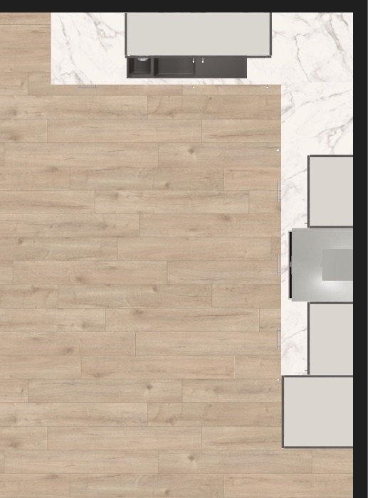
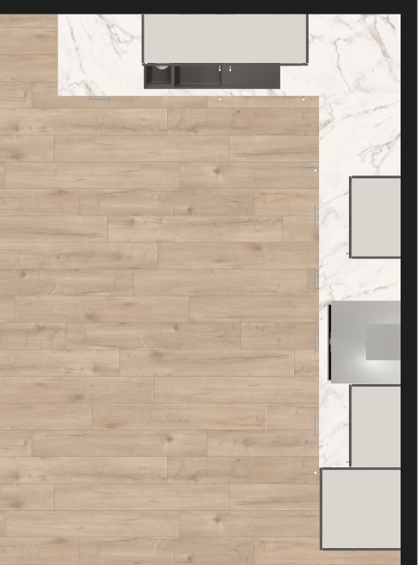
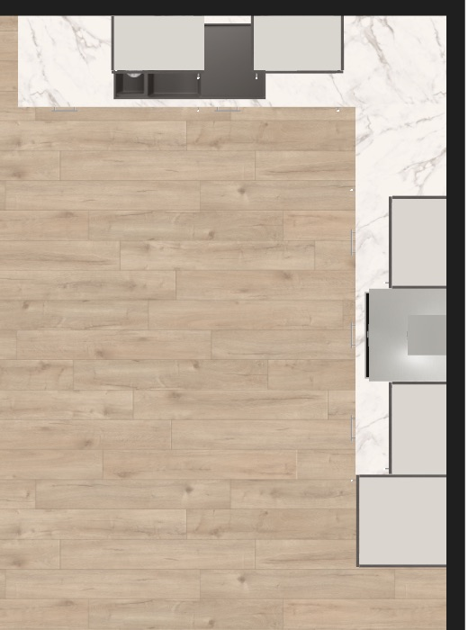

# insert-article-into-group takes a between-pair whose root modules do not stand side by side

> **Type**: Bug analysis
> **Status**: Open
> **Date**: 2026-10-24
> **Base**: roomle-hi-example `master` (`5853630`); roomle-ui `feat/hi-mcp` (`653fd7d99`)
> **Backlog**: [mcp-issues.md #85](../backlog/mcp-issues.md#85-insert-article-into-group-takes-a-between-pair-whose-root-modules-do-not-stand-side-by-side)

## Affected repositories

- **roomle-ui** (`feat/hi-mcp`) — one unit test in
  `homag-intelligence/__tests__/hi-tool-commands/group-commands-test.ts`: an insert between two root
  modules on the two legs of an L, with a corner article between them, gets correction C19 and
  goes beside the first-named root module. The tool command, `insertBetween`, the served
  description and `.agents/homag-intelligence/hi-tools-behaviour.md` stay as they are.
- **roomle-hi-example** — this analysis, and backlog item 85, which leaves the backlog.
- **ligna-store** — unchanged. No new embedding-lib version is needed.

The roomle-ui paths are relative to `packages/web-sdk/packages/`. The D-, C- and G-numbers are the
decisions, corrections and guards of
[roomle-ui `hi-tools-behaviour.md`](https://github.com/roomle-dev/roomle-ui/blob/master/.agents/homag-intelligence/hi-tools-behaviour.md).

## Result

The defect the backlog item describes does not reproduce. The tool never inserts silently between
two root modules that do not stand side by side:

- Two root modules that are **side neighbours** — one docks its `LeftBottom` or `RightBottom` to
  the other's — stand side by side, because that docking places them there. The article goes
  between them.
- Two root modules of **one row that are not neighbours** — on two legs of an L, or with other root
  modules between them — get correction C19. The article goes beside the first-named root module,
  towards the second, and the result says between which two root modules it went.
- Two root modules that are **in no row together** are refused (G52), with the side neighbours of
  the first.

The recorded run came from the test's premise, not from the tool. The prompt named two root
modules on two legs of the L. The prompt has named two side neighbours since 2026-10-20.

## Symptom (as recorded)

`mcp-test-2026-10-19_07-42-07`, gpt-6-astra test 27 (`edit-insert-below-wall-units`, local
roomle-ui :5173), from the backlog record: "the model named the sink and a base unit (adjacent in
the docking chain, not side by side in space); the insert landed beside the sink." The run
directory is no longer on disk. Which base unit the model named, and whether the result carried a
correction, cannot be told any more.

The prompt of the test on that day was "insert a base unit with drawers between the hob unit and
the sink unit". The plan `corner-kitchen-wall-units` (`ps_s7hy5nqvtts37wl79u6q8tq67bc12s2`) had been
replaced the day before (`2a71c0c`, 2026-10-18). In the new plan the hob and the sink stand on two
different legs of the L.

### The plan

The base row runs along the docking from `RightBottom` to `LeftBottom`, around the back right
corner:

| Leg | Root modules, in row order |
|---|---|
| Back wall | dishwasher `GSP` `27d63628` → sink `SUT60` `31616143` → `UTB60` `46ce47e7` |
| Corner | corner unit `UERTB90` `814c6854` |
| Right wall | drawer unit `US2A60` `7cd04e00` → hob unit `UKS2A60` `379fa7a9` → drawer unit `US2A60` `b9bbab7e` → tall fridge unit `HK60` `ad52e21b` |

The hob and the sink are five root modules apart, with the corner unit between them. No insert can
put an article "between" them in the sense of the description.

### Reproduction (model-free)

On the plan above, `insert-article-into-group` of `US2A30` (300 mm) was called with five
`between` pairs, and each insert was undone. The calls went through `callExternalObjectAgentTool`
on the planner of roomle-ui `feat/hi-mcp` (`653fd7d99`, an own dev server). Script and output:
`.temp/result/repro-insert-between-not-side-by-side-2026-10-24/`.

| # | `between` | Side neighbours | The article went between | `corrections` |
|---|---|---|---|---|
| 01 | hob, sink | no — two legs | the hob and `7cd04e00`, towards the corner | C19: "… are not neighbours - the unit was inserted between '379fa7a9…' and '7cd04e00…', the neighbour of '379fa7a9…' towards '31616143…'" |
| 02 | sink, hob | no — two legs | the sink and `UTB60`, towards the corner | C19, the same sentence with the sink first |
| 03 | sink, `UTB60` | yes | the sink and `UTB60` | none |
| 04 | `UTB60`, `7cd04e00` — both beside the corner unit | no — two legs | `UTB60` and the corner unit | C19 |
| 05 | hob, `b9bbab7e` — the pair of today's prompt | yes | the hob and `b9bbab7e` | none |

In every case the root modules at the wall kept their place (D41). The others moved by 300 mm,
together with the units above them, and the `hint` named those units. In 01 the right leg grows
towards the front, and the hob, the range hood and the fridge move. In 02 the back leg grows to the
left, and the sink and the dishwasher move.

| 01: hob, sink | 02: sink, hob |
|---|---|
|  |  |

The recorded symptom, "the model named the sink and a base unit; the insert landed beside the
sink", fits two of these rows. It fits 03 (the sink and its side neighbour `UTB60`: the article goes
between them, with no correction needed) and 02 (the sink and a root module of the other leg: C19).
In neither case did the tool do something other than what the payload asked, and in neither did it
leave a correction unreported.

The three runs of the test since the prompt was rewritten all named the hob and `b9bbab7e`, and all
three results had no correction (`mcp-test-2026-10-21_12-49-36` gpt-6-astra 31,
`mcp-test-2026-10-21_16-59-20` mistral-large-4 31, `mcp-test-2026-10-22_19-45-49` gpt-6-astra 22).

## Investigation trace

1. **The tool command resolves the pair before the planner call.**
   `'insert-article-into-group'` (`homag-intelligence/src/hi-tool-commands.ts:1348-1389`) resolves the
   group, the article and both root ids (C17, G15). It then passes the pair through
   `insertBetween` and forwards the pair it returns to `externalObjectGroupOperation`.
2. **`insertBetween` tests the pair against the docking**
   (`homag-intelligence/src/hi-tool-docking.ts:252-279`). Its neighbours are the side partners of the
   first root, read by `sidePartnersOf` (`:378`) over the side docking vectors `LeftBottom` and
   `RightBottom` (`SIDE_VECTORS`, `:340`). If the second root is one of them, the pair goes to the
   planner unchanged.
3. **A pair that is not neighbours walks the row.** `neighbourTowards` (`:233-250`) follows one side
   vector from root module to root module. The walk passes a corner article, which docks its
   `LeftBottom` and `RightBottom` like every other root module. If the walk reaches the second root,
   the article goes between the first root and its neighbour in that direction, and the correction
   names both (`:268-273`, C19). If neither direction reaches it, the call fails with the side
   neighbours of the first root (`:276-278`, G52).
4. **Side neighbours stand side by side.** The docking from a `rightOf` or `leftOf` relation pairs
   one root module's `RightBottom` with the next one's `LeftBottom`, `StartStart`, offset 0
   (`pairOf`, `homag-intelligence/src/hi-group-layout.ts:873-885`). The planner arranges the two
   along that edge, so two side partners always touch along the row. Two root modules that are adjacent in the chain
   only through a third one — the two root modules beside a corner unit (04) — are not side
   partners, and they get C19.
5. **The behaviour is documented and unit-tested for a straight row.** C19 and G52 are rows of §8.5
   of `hi-tools-behaviour.md`, and the row of the tool in §6 names C19. In
   `homag-intelligence/__tests__/hi-tool-commands/group-commands-test.ts`, the tests at `:2055`,
   `:2065` and `:2077` cover a pair of neighbours, a pair with one root module between them, and a
   pair in no row together. The fixture is a straight row `r1 → r2 → r3`; no test has a corner
   article between the two root modules.
6. **The correction path existed when the run was recorded.** The neighbour test with this
   correction came with the row edit tools (`15144ec`, roomle-hi-example, 2026-10-06) and moved to
   roomle-ui with the tool commands (`16863864f`, 2026-10-15). The run of 2026-10-19 ran with it.

## Root cause

There is no defect in the tools. The recorded run had a broken test premise:

- **The plan was replaced, the prompt was not.** `2a71c0c` (2026-10-18) replaced the plan of
  `corner-kitchen-wall-units`, which put the sink on the back leg. The prompt of
  `edit-insert-below-wall-units` still asked for an insert "between the hob unit and the sink unit",
  which named two root modules on two legs. A model then has three valid choices: send one of the
  two C19 pairs, send the sink and its side neighbour, or ask back. The run of 2026-10-19 built
  beside the sink. The run of 2026-10-20 asked (gpt-6-astra 30).
- **The prompt names two side neighbours since `5ec7351` (2026-10-20):** "between the hob unit and
  the drawer unit next to the fridge" (`docs/test-prompts.json:208-213`).

## Why the backlog's cause does not hold

The item's cause says "the payload's between-ids are not tested against the geometry — chain
adjacency is enough for the insert, and the result does not say that the named pair does not stand
side by side". On `feat/hi-mcp`:

- **The ids are tested.** `insertBetween` takes a pair as it is only when the two are side
  partners, and side partners stand side by side. Chain adjacency through a third root module is
  not enough (04).
- **The result says so.** Every other pair of one row gets C19, which names where the article went
  (01, 02, 04). This is the feedback the item's To do asks for: "the result says so and where the
  article landed — feedback, not a refusal".

The item's other option, "one sentence in the served description says what side by side means", is
not needed. The plan context gives every root module its docking (`contextData`), and the three
runs with a pair of neighbours in the prompt picked that pair.

## Proposed fix

No change to the tool, the served text or the behaviour reference. Two steps close the item:

1. **roomle-ui `feat/hi-mcp`: guard C19 across a corner article.** Add one test in the
   `insert-article-into-group` block of `group-commands-test.ts`: a row `r1 → corner → r3`, where the
   corner root module is a `cornerArticle: true` article (as in the corner fixture of the merge
   tests at `:1309`). `between: ['r1', 'r3']` forwards `['r1', 'corner']` and returns the C19
   correction. Proposed name: `it('inserts beside the first-named root, past a corner article, when the two stand on two legs')`.
   The test pins the L-shape case of the item. The merge's `rowWalk` stops at a corner article,
   and the test keeps `neighbourTowards` from being changed the same way without anyone noticing.
2. **roomle-hi-example: remove backlog item 85** once the test is in. Delete this analysis with
   the close-out; nothing here needs to go into the living reference, because C19 and G52 already
   describe the behaviour.

## Alternatives rejected

- **A geometric check of the pair (the outlines of the two root modules touch).** Side partners
  touch by construction, and C19 handles every other pair of one row. A second test of the same
  question would add code without adding a case.
- **A served sentence on what side by side means.** The description already says "two root modules
  … that stand side by side", and no run since the prompt was fixed got it wrong. A longer
  description goes against "shorter, not longer" (Guards Are a Last Resort, step 1).
- **Refusing a pair that is not neighbours.** C19 builds and reports. A refusal costs the agent a
  step and throws away a payload whose intent is clear (Guards Are a Last Resort, step 3).
- **A new test prompt with two root modules on two legs.** The model asks back on such a prompt
  (2026-10-20 run, test 30). A question back is a matter of how the prompt is worded, not of the
  MCP, and the unit test covers the tool's side.

## Out of scope

- **A wall unit beside a tall unit.** `insertBetween` reads only `LeftBottom` and `RightBottom`. A
  wall unit that hangs beside a tall unit with the tops flush is docked by `RightTop` → `LeftTop`
  (`pairOf`, `hi-group-layout.ts:878`; `5b754b36` beside the fridge `ad52e21b` in this plan), so
  the two are in no row together for the insert. Inserting a wall unit between them is refused with G52. This is from reading the code: it
  was not replayed, and no run asks for it.
