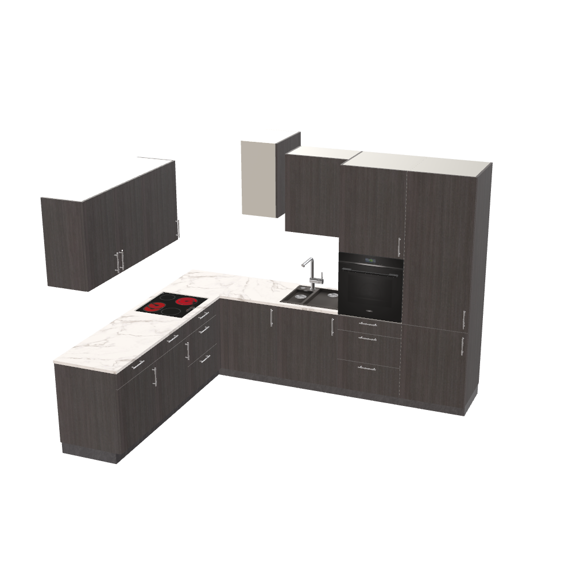

# Bug analysis: a wall unit over the corner article is turned out through the wall by the carrier link of a placement by wall

> **Type**: Bug analysis
> **Status**: Open — the fix is proposed below
> **Date**: 2026-10-24
> **Base**: roomle-hi-example `master` `b9ce53d`; roomle-ui `feat/hi-mcp` `f9d0da359` (local — the
> seven commits of 2026-10-24); the deployed `release/bo-test` `1d9adf51e` (merge base `1a7fc84a2`,
> 2026-10-23, none of the commits of 2026-10-24)
> **Backlog**: [mcp-issues.md 109](../backlog/mcp-issues.md#109-a-wall-unit-over-the-corner-article-is-turned-out-through-the-wall-by-the-reload-of-a-placement-by-wall)

## Affected repositories

- **roomle-ui**, branch `feat/hi-mcp`: the carrier link before a reload (`hi-wall-placement.ts`:
  `withUnitsAboveDocked`), its tests (`__tests__/hi-tool-commands/place-group-test.ts`,
  `__tests__/hi-tool-commands/create-or-replace-groups-placement-test.ts`), and
  `.agents/homag-intelligence/hi-tools-behaviour.md` (C24), `layout-and-placement.md` and
  `tool-executors.md`.
- **roomle-hi-example**: documentation and tests only — this analysis, the backlog item, a test of
  the category "planning from images" with `kitchen-11.png` in [`docs/test-prompts.json`](../../docs/test-prompts.json),
  and the planning results of the kitchens 11 to 15 once the fix is on the planner.
- **ligna-store**: unchanged. The fix lives in the planner, so the store gets it with the planner at
  its server URL. No new embedding-lib version: the forwarding of `createHiMcpTools` does not change.

The roomle-ui paths below are relative to `packages/web-sdk/packages/homag-intelligence/src/`; the
line numbers are those of `f9d0da359`.

## Symptom

The HI chat plans [`docs/images/kitchen-11.png`](../../docs/images/kitchen-11.png) — an L-shaped
kitchen with a column of tall units on the right, wall units along the back wall and one wall unit
beside the tall units, over the corner — into the back right corner of a 5500 × 5000 mm room
(plan snapshot `ps_srfqpet9mui0uiq7ubkui78kadflwbd`, the plan after several corrections by the
user). One wall unit stands in the wall: it reaches 600 mm beyond the right wall, and it is turned
by 90° against the row it belongs to.

The plan, read from the snapshot with the planner of `f9d0da359`:

| What | Value |
|---|---|
| The group | one L-shaped group, `pos` `[4815, 3765, 0]` (the back right corner), `rotationZ` 270 — placed into the corner as asked |
| The right wall | `x = 4815`; the room lies at `x < 4815` |
| The wall unit `0f0c5df9` (`OTB60`) | outline `x` 4815 to 5415, `y` 2803 to 3204, height 1530 to 2250: its 600 mm width runs along `x`, through the wall; the other wall unit of the right wall (`d4c8c03c`, over the sink unit) runs along `y` as the right-wall row does |
| Its docking | `RightBottom → d4c8c03c:LeftBottom`, `RightTop → d4c8c03c:LeftTop` (it is `leftOf` the wall unit that hangs beside the tall oven unit) **and** `LeftBottom → ed1ed64f:LeftTop`, mode `StartStart`, offset `[-561, -660, 661]` — `ed1ed64f` is the corner article `UERTB90` |
| Its position in the group | `articlePos` `[561, 1530, 600]`, `rotationY` 90 — the place of a unit `leftOf` `d4c8c03c` (`[1161, 1530, 600]` − 600 in `x`), but turned by 90° |

The third docking entry is the signature of the server's carrier link (`withUnitsAboveDocked`): a
`LeftBottom → LeftTop` pair in mode `StartStart` with an offset that has `x` and `z` components. A
wall unit the agent hangs with `above` carries `[0, −gap, 0]` only.



The user also reports that the first attempt of the chat placed the kitchen off the wall, and that
the island of [`docs/images/kitchen-5.png`](../../docs/images/kitchen-5.png) came out turned by 90°.
Neither has a plan snapshot or a run log; see [What is not reproduced](#what-is-not-reproduced).

## Reproduction

Model-free, with `window.instance.extended.callExternalObjectAgentTool` in the example page on the
room of the snapshot (`ps_srfqpet9mui0uiq7ubkui78kadflwbd`, its group deleted first), twice: on
`f9d0da359` with a dev server of its own on `:5174` (launcher
`EXAMPLE_PORT=3002 HI_CHAT_PORT=3202 EXAMPLE_SERVER_URL=http://localhost:5174/ node minimal-hi-example/start.mjs --dev --no-open`),
and on the deployed `release/bo-test` planner (the launcher without `--dev`), which has none of the
commits of 2026-10-24. The scripts and their outputs are in
`.temp/result/repro-wall-unit-over-the-corner-2026-10-24/` (`replay-l-kitchen.mjs`, `replay-new/`,
`replay-old/`; `dump-plan.mjs` reads a snapshot).

The group is the kitchen of the image in the shape the served rules ask for: the corner article
first, the back-wall leg `leftOf` it, the right-wall leg `rightOf` it, the wall units of the back
wall `above` a base unit and `rightOf` each other, and the two wall units of the right wall beside
the tall oven unit — `wR1` `leftOf` the oven, `wR2` `leftOf` `wR1`, which puts `wR2` over the right
leg of the corner article, as the photo shows it.

```json
{ "posGroups": [{ "libraryId": "Furniture_Smith", "placement": { "wall": "right", "alignment": "back" }, "roots": [
  { "id": "corner", "articleId": "UERTB90" },
  { "id": "hob", "articleId": "UKS2A60", "leftOf": "corner" },
  { "id": "b1", "articleId": "USTB60", "leftOf": "hob" },
  { "id": "b2", "articleId": "USTB60", "leftOf": "b1" },
  { "id": "sink", "articleId": "SUT60", "rightOf": "corner" },
  { "id": "oven", "articleId": "HOTS2AB60", "rightOf": "sink" },
  { "id": "fridge", "articleId": "HK260", "rightOf": "oven" },
  { "id": "wB1", "articleId": "O2TB90", "above": "b2" },
  { "id": "wB2", "articleId": "OTB60", "rightOf": "wB1" },
  { "id": "wR1", "articleId": "OTB60", "leftOf": "oven" },
  { "id": "wR2", "articleId": "OTB60", "leftOf": "wR1" }
] }] }
```

| Step | On `f9d0da359` | On `release/bo-test` |
|---|---|---|
| `create-or-replace-groups`, placement `{ wall: right, alignment: back }` | the group at `[4815, 3765, 0]`, 270 — in the corner. `wR2` at `x` 4815 to 5415, `rotationY` 90, docked `LeftBottom → corner:LeftTop [-561, -660, 661]` — **the symptom** | the same: `wR2` at `x` 4815 to 5415, `rotationY` 90, the same docking entry |
| `place-group` `{ wall: right, alignment: back }` afterwards, twice | "already stands at the right wall as asked - nothing was reloaded"; the plan unchanged | not run |
| the same group by point, `{ posGroup: [4815, 3765, 0], posRotationZ: 270 }` (`posGroup: [4815, 0, -3765], posRotationY: 270` on bo-test) | the group at the same place. `wR2` at `x` 4409 to 4815, `y` 2604 to 3204, `rotationY` 0, docked to `wR1` only — **right**: over the right leg of the corner article, inside the room | the same, right |
| an island of three base units by point, `posRotationZ` 0 and 90 | 0: the row along `+x` with its front towards `−y`; 90: the row along `+y` — right | the same, right |

The placement by wall of the group is right on both builds — the corner point and the rotation are
those of the corner. What differs between the create by wall and the create by point is the reload
of the placement by wall and what it does to `wR2`. The defect is on the deployed planner of
2026-10-23 as well: **the commits of 2026-10-24 do not cause it.** The scenario is new: the earlier
corner runs (44, 50, 52 and 67 of `mcp-test-2026-10-22_19-45-49`) hang every wall unit `above` a
base unit; none has a wall unit over the corner article, and the planning results of 2026-10-15
cover the kitchens 1 to 10. `kitchen-11.png` is the first image with a wall unit over the corner
beside a column of tall units.

## Investigation

### The path of a placement by wall

1. `create-or-replace-groups` loads the group where the planner puts it, because the wall
   arithmetic needs the calculated group (`placeAtWalls`, `hi-tool-commands.ts:232`).
2. `wallTarget` (`hi-wall-placement.ts`) computes the corner placement from the calculated group:
   `[4815, 3765, 0]`, 270 — right.
3. `repositionedGroup` (`hi-wall-placement.ts:162`) builds the group for the reload: every root
   without its position (`withoutPositions`, `:46`), the placement as `repositioningData` of the
   first article root, and — first of all — `withUnitsAboveDocked(calculatedGroup)` (`:166`).
4. The planner reloads the group (`HI_LOAD_OBJECT_REASON.ADJUSTED`, `hi-tool-commands.ts:287`
   for the create, `:847` and `:877` for `place-group`); the kernel places every root by its
   docking, since no root carries a position.

A placement by point sends no reload (3.6 of roomle-ui
[coordinate-systems.md](https://github.com/roomle-dev/roomle-ui/blob/master/.agents/homag-intelligence/coordinate-systems.md)):
the group is loaded once, from the agent's relations, and `wR2` is right.

### What `withUnitsAboveDocked` does with `wR2`

`withUnitsAboveDocked` (`hi-wall-placement.ts:67-160`, C24 of
[hi-tools-behaviour.md](https://github.com/roomle-dev/roomle-ui/blob/master/.agents/homag-intelligence/hi-tools-behaviour.md#8-guards-corrections-and-feedback))
exists because the kernel's calculated group links only docking vectors that touch: a wall unit
hanging with a gap above a base unit is docked to nothing below it, and a reload without positions
would put it on the floor. So, for every root, it finds the carrier by position (`:93-104`): the
highest root module below it whose docking-vector box contains the unit's centre. Unless the unit
is already docked Top-to-Bottom to that carrier (`dockedTo`, `:73-87`), it adds to the carrier's
`LeftTop` an entry `{ id: unit, dockingVector: 'LeftBottom', mode: 'StartStart', offset }`
(`:108-121`), the offset being the unit's `LeftBottom` start minus the carrier's `LeftTop` start in
group space.

For `wR2`, in the calculated group of step 1:

| | Group space (pos space, `y` up) |
|---|---|
| `wR2`, `OTB60`, `rotationY` 0 | `articlePos` `[561, 1480, 600]`, centre over `x` 861, `z` 775; its `LeftBottom` starts at its origin and runs along its local `+z` (`[0, 0, 350]`) |
| the corner article `UERTB90`, `rotationY` 0 | `articlePos` `[261, 0, 600]`; its docking-vector box spans `x` 0 to 1161, `z` 600 to 1261 — the centre of `wR2` lies in it, its top (870) lies below the unit's bottom (1480): the corner article is the carrier |
| the carrier's `LeftTop` | starts at `[-261, 820, 661]` in the article's frame — at the far end of the back-wall leg, where the row `leftOf` the corner docks — and runs along the article's `+x` (`[561, 0, 0]`) |
| the carrier's `RightTop` | starts at `[900, 820, 0]` and runs along `+z` (`[0, 0, 561]`), like the vectors of a straight unit |

`wR2` is not docked to the corner article (it hangs by `RightBottom`/`RightTop` on `wR1`, which
hangs by `RightTop` on the oven unit's `LeftTop`), so the function adds the link to the corner's
`LeftTop` with the offset `[561, 660, −661]` (its mirror on the unit `[−561, −660, 661]`, the entry
of the snapshot).

### Why the link turns the unit

The kernel docks a vector pair in mode `StartStart` by aligning the two vectors: the start of the
unit's vector on the start of the carrier's vector, offset by the entry's offset, **and the
direction of the unit's vector on the direction of the carrier's vector**. The corner article's
`LeftTop` runs along `+x`, the unit's `LeftBottom` along its local `+z`: to lay the one on the other
the kernel turns the unit by 90° (`rotationY` 90 — the unit's local `+x` turns to group `−z`). The
offset is applied in the group's frame, so the start point stays where it was: the unit keeps its
back left corner at `[561, 1480, 600]` and swings its 600 mm width from `+x` to `−z` — from over
the corner article's right leg to beyond `z = 0` of the group, which is the right wall of the room.

C24 says the entry keeps the unit "where it stands, in the group's frame — also on a turned leg".
That holds for the start point and for a carrier whose vectors run the unit's way: a base unit of
the turned leg is turned with the wall unit above it, so the two vectors run the same way. It does
not hold for the corner article, whose `Left` vectors run across the unit over its right leg. The
agent is told never to hang a wall unit on or above the corner article for exactly this reason
(the served rule "never put a wall unit on or above the corner article"); the server does it
itself, by position, in the reload of every placement by wall and of every `place-group`.

### Root cause

`withUnitsAboveDocked` (`hi-wall-placement.ts:108-121`) docks a unit to its carrier's `LeftTop`
without checking that this vector runs the way the unit's `LeftBottom` runs. A carrier link that
turns the unit is wrong by construction: the link exists only to keep the unit where it stands.

A second gap makes the link needless here: the function links a unit whose docking already holds
it. `dockedTo` (`:73-87`) looks for a Top-to-Bottom pair between the unit and that one carrier
only; `wR2` is held through its side docking on `wR1` and `wR1`'s docking on the tall unit, as the
create by point shows — a reload without positions keeps it in place by that chain.

### What is not reproduced

- **The first attempt off the wall.** The placement by wall and the placement by point put the
  group into the corner on both builds. The chat's first payload is not recorded (the snapshot is
  the plan after the corrections, the plan was made in the ligna-store test chat), so what the
  model sent — a wall placement, a point, which group — is unknown. The run log
  (`planner-calls.json` of a `run-hi-mcp-prompt.js` run with the image) would show it.
- **The island of `kitchen-5.png` turned by 90°.** A placement by point with `posRotationZ` 0 and
  90 turns the row as the rule says on both builds, and the plan has no reload for a group by
  point, so the carrier link is not involved. The result has no snapshot; the chat run would show
  whether the model sent 90 and why.

Both need a chat run with the image on the planner of `f9d0da359` (`run-hi-mcp-prompt.js` with
`--image` and `--plan`), which this analysis does not start.

## Proposed fix

In `withUnitsAboveDocked` (roomle-ui `hi-wall-placement.ts`), both parts, in the tool layer — no
served rule, no guard, no change of the planner's logic:

1. **The link never turns the unit.** Of the carrier's `Top` docking vectors, take the one that
   runs the way the unit's `LeftBottom` runs — the directions of the docking vectors in group space
   are known (`dockInfos` start and end, as `dockingVectorBox` reads them) — and dock the unit's
   `LeftBottom` to it with the offset from that vector's start. For a straight carrier that is its
   `LeftTop`, as today; for a unit over the right leg of a corner article it is the corner's
   `RightTop`. With no vector that runs the unit's way, add no link.
2. **No link for a unit the docking holds.** A unit that reaches, over the docking entries of the
   calculated group in either direction, a root module standing on the floor keeps its position in
   the reload — the kernel places it by that chain — and gets no link. `wR2` → `wR1` → the oven
   unit is such a chain. The link stays for a unit the kernel left unlinked: a wall unit hanging
   with a gap, a range hood.

Part 1 is the fix of the defect; part 2 removes the work that triggered it and keeps the reload
close to the group the agent built. Neither depends on a library: both read the geometry of the
calculated group.

### Tests

- roomle-ui `__tests__/hi-tool-commands/place-group-test.ts`, beside
  `it('docks a wall unit hanging above a floor unit to it again before the reload, so it keeps its place')`:
  a wall unit `leftOf` the wall unit beside the tall unit, over a corner article whose `Left`
  vectors run across it — the reload sends it without a link to the corner article, and a unit
  above the corner article's leg whose vertical docking the kernel dropped is docked to the `Top`
  vector that runs its way.
- roomle-ui `__tests__/hi-tool-commands/create-or-replace-groups-placement-test.ts`: the same
  group created with a placement by wall — the reloaded roots keep the docking of the calculated
  group, with no entry on the corner article.
- roomle-hi-example `docs/test-prompts.json`, category "planning from images": `kitchen-11.png` in
  the back right corner, expecting every wall unit inside the room and the wall unit over the corner
  turned as the right-wall row is.
- The model-free replay above on the fixed planner: `wR2` at `x` 4409 to 4815, `rotationY` 0 after
  the create by wall and after `place-group`.

### Documentation

roomle-ui `.agents/homag-intelligence/hi-tools-behaviour.md` C24 (the link docks to the carrier's
`Top` vector that runs the unit's way and never turns it; a unit the docking holds gets none),
`layout-and-placement.md` and `tool-executors.md` where they describe `withUnitsAboveDocked`.
