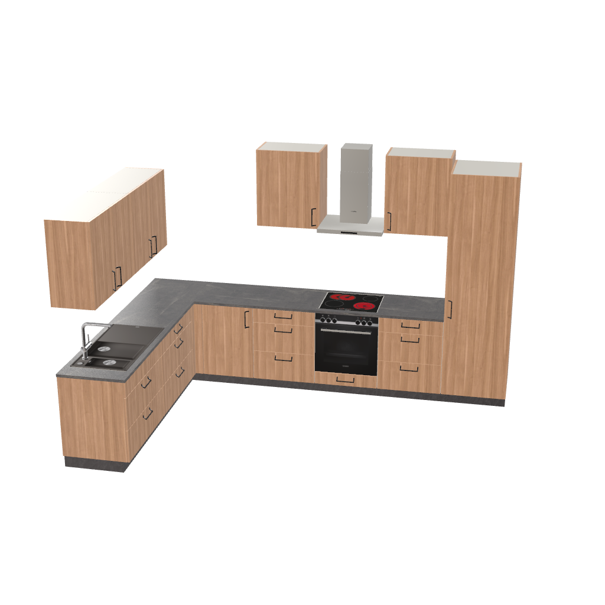

# Bug analysis — the wall units beside the range hood hang higher than the other wall units

> **Type**: Bug analysis
> **Status**: Open
> **Date**: 2026-10-23
> **Base**: roomle-hi-example `master` (`3623f83`), branch `docs/analyse-wall-units-beside-the-hood`;
> roomle-ui `feat/hi-mcp` (`0b65e3cb0`). The run's build, bo-test `205cc9bc8`, serves the same text:
> between the two, the HI sources differ in `hi-mcp/agent-facing.ts` and `hi-mcp/tool-executors.ts` only
> **Backlog**: item 97 of [`../backlog/mcp-issues.md`](../backlog/mcp-issues.md)

## Affected repositories

- **roomle-ui** (`feat/hi-mcp`) — the fix: two sentences of the served rules (`AUTHORING_RULES`,
  `packages/web-sdk/packages/homag-intelligence/src/hi-mcp/hi-mcp-server.ts:28,30`), their test in
  `__tests__/hi-mcp/hi-mcp-server-test.ts`, and a decision row in §3 of
  `.agents/homag-intelligence/hi-tools-behaviour.md`. The tool command stays as it is:
  `relationsToDocking` (`hi-group-layout.ts`) builds what the agent sends.
- **roomle-hi-example** — this analysis, backlog item 97, and the relations section of
  [`.agents/skills/hi-authoring-rules.md`](../skills/hi-authoring-rules.md) (lines 91 and 94), which
  repeats the served rule.
- **ligna-store** — no change: it runs the planner's tools and holds no copy of the rules.
- **HOMAG library** — no change: the hood's desc ("Mounted above the hob, in the wall-unit row or
  as an island hood") is right and says nothing about heights.

## Symptom

Test `full-kitchen-walnut-marble-corner` (plan `default-room`), gpt-6-astra, session
`mcp-test-2026-10-22_19-45-49`, run 52 (bo-test `205cc9bc8`): an L-shaped kitchen in the back right
corner. The wall units of the right leg, beside the range hood, hang 150 mm higher than the wall
units of the back leg:

| Root | Article | Relation sent | `mod_HeightPosInsertion` | Top |
|---|---|---|---|---|
| `wallprep` | O2TB90 | `above` `prep`, `gapMm` 600 | 1420 | 2140 |
| `wallsink` | O2TB90 | `leftOf` `wallprep` | 1420 | 2140 |
| `wallright` | OTB60 | `above` `landing1`, `gapMm` **750** | **1570** | 2290 |
| `hood` | DU | `rightOf` `wallright` | bottom with `wallright` | — |
| `wallend` | OTB60 | `rightOf` `hood` | **1570** | 2290 |
| `fridge` | HK60 (tall, 2100) | `rightOf` `landing2` | 100 | 2200 |



The answer says "Four matching wall cabinets across both walls".

The same test showed the same payload in `mcp-test-2026-10-21_12-49-36`, gpt-6-astra 50:
`wallRight` `above` `prepRight` with `gapMm` 750, `hood` `rightOf` `wallRight`, `wallLanding`
`rightOf` `hood`, the back leg with `gapMm` 600; the right leg hangs at 1570, the back leg at 1420.

## Investigation trace

### What the model sent

`planner-calls.json` of run 52, call 5 (`create-or-replace-groups`): the roots of the table above.
The model sent a height for both legs: `gapMm` 600 for the back leg's first wall unit, `gapMm` 750
for the right leg's. The backlog item's "the model sent no height" is not accurate.

### What the tool command built

The run's roots replayed through `relationsToDocking` (roomle-ui `hi-group-layout.ts:265`) with the
catalog of `__tests__/hi-group-layout-test.ts`, in a scratch vitest (deleted after the run):

```text
prep.LeftTop -> wallprep.LeftBottom StartStart [0,600,0]
wallprep.LeftBottom -> wallsink.RightBottom StartStart [0,0,0]
landing1.LeftTop -> wallright.LeftBottom StartStart [0,750,0]
wallright.RightBottom -> hood.LeftBottom StartStart [0,0,0]
hood.RightBottom -> wallend.LeftBottom StartStart [0,0,0]
corrections []
```

- An `above` with `gapMm` takes the gap as sent (`hi-group-layout.ts:902-912`); without `gapMm` it
  takes the hang gap of D35 (`hangGapOf`, `hi-group-layout.ts:226`): tall 2100 − wall 720 − base 720
  = 660, which puts the top of the wall units at the top of the fridge.
- A `rightOf` between two units at wall level docks their Bottom vectors (`pairOf`,
  `hi-group-layout.ts:873-884`; the edge is Top only beside a tall unit, `:878`). The hood and
  `wallend` hang with their bottoms at the bottom of `wallright`. This is designed and guarded
  (`it('docks wall units and the range hood beside each other by the Bottom vectors')`,
  `__tests__/hi-group-layout-test.ts:266`).

No correction is reported, because the tool changed nothing in the input.

### What the planner and the library did

The base units stand on a 100 mm plinth with a 720 mm carcase: their docking top is at 820. The
plan context after the create (`plan-context.json`) has 820 + 600 = 1420 for the back leg and
820 + 750 = 1570 for the right leg: the planner and the library hung each unit exactly where its
docking put it.

### What the served text tells the model

`AUTHORING_RULES` (roomle-ui `hi-mcp-server.ts`), read by the model in call 3
(`get-authoring-rules`):

- `:12` (`MOUNTING_GUIDANCE`, also in the descriptions of `get-plan-context` and
  `create-or-replace-groups`): "For an article used at wall level, above names the root module below
  it and gapMm sets the clearance".
- `:28`: "`above: "<id>"` - a wall unit hanging above that floor-standing root module, at the height of
  the wall units; gapMm sets the gap below the wall unit instead." The sentence does not say which
  height "the height of the wall units" is, or that the wall units of one group share it.
- `:30`: "… further wall units **and the range hood continue rightOf or leftOf each other**. Without a
  tall unit, the first wall unit hangs above a floor unit and the next ones continue rightOf or
  leftOf it; **a range hood without wall units hangs above the hob unit**."
- `:31` (corner kitchens): "The wall units of each leg hang above the floor units of that leg: the
  first one above a floor unit of the leg, the next ones rightOf or leftOf it". Each leg gets an
  `above` of its own, so each leg carries its own `gapMm`.

The kitchen planning skill gives no hood clearance ("Hood, hob, combustible surfaces | Use exact
product and applicable local requirements. | No generic numeric default.",
`skills/kitchen-planning/references/planning-reference.md:28`). The 650 to 750 mm come from the
model's general knowledge.

### What the model does with the range hood

The six runs of `full-kitchen-walnut-marble-corner` in `.temp/result`:

| Session | Model | Hood | Wall units `above` | Heights |
|---|---|---|---|---|
| `2026-10-18_08-45-09` 40 | gpt-6.1-sol | `above` the hob, `gapMm` 650 | no `gapMm` | one |
| `2026-10-21_12-49-36` 50 | gpt-6-astra | `rightOf` a wall unit | 600 and 750 | **two** |
| `2026-10-21_16-59-20` 50 | mistral-large-4 | `rightOf` a wall unit | no `gapMm` | one |
| `2026-10-22_07-57-33` 05 | gpt-6-astra | `above` the oven unit, `gapMm` 750 | no `gapMm` | one |
| `2026-10-22_09-29-56` 05 | gpt-6-astra | `above` the hob, `gapMm` 650 | no `gapMm` | one |
| `2026-10-22_19-45-49` 52 | gpt-6-astra | `rightOf` a wall unit | 600 and 750 | **two** |

Across the three gpt-6-astra sessions of 2026-10-22, the model planned a range hood in 21 runs. It
hung the hood `above` the hob unit in 15 of them, 14 times with a `gapMm` of 650 to 750 mm. In the
other 6 it put the hood into the wall-unit row as the rule at `:30` says. A wall unit `above` a floor
unit gets a `gapMm` of 600, 650 or 660, or none. Only in runs 50 and 52 of this test does a wall unit
get 750 mm, the model's hood clearance: there it is the first wall unit of the row that carries the
hood.

The second half of the cause also appears without a hood. In `mcp-test-2026-10-22_09-29-56`
gpt-6-astra 10 (`image-only-no-text`), one group has two wall units `rightOf` the fridge (tops
flush with it, 1480) and one `above` a base unit with `gapMm` 600 (1420).

## Root cause

The served rules lead the model to give the wall units of one group two heights. The tool command,
the planner and the library build what the model sends.

1. **The range hood rule** (roomle-ui `hi-mcp-server.ts:30`): "further wall units and the range
   hood continue rightOf or leftOf each other" puts the hood into the wall-unit row. There its
   bottom is docked to the bottom of the wall unit beside it (`hi-group-layout.ts:873-884`). The
   hood's clearance above the hob is then the `gapMm` of the first wall unit of its row. The model
   gives a hood 650 to 750 mm above the hob. With the hood in the row, the only place for that
   number is the `gapMm` of `wallright`, and it lifts the whole leg: `wallright`, the hood and
   `wallend`.
2. **The `above` relation** (roomle-ui `hi-mcp-server.ts:28`) says "at the height of the wall
   units" without naming the height (tops flush with the tall units, D35). It does not say that
   every wall unit of a group hangs at it. `gapMm` "sets the gap below the wall unit instead", one
   relation at a time. The corner rule (`:31`) gives each leg its own `above`, so nothing tells
   the model that the two gaps must match. Here it sent 600 for one leg and 750 for the other.

## Why the current code produces this

The served text teaches a row in which one number does two jobs: the `gapMm` of the row's first
wall unit is the height of the wall units and the hood's clearance above the hob. The other leg
has a number of its own. The model sets the hood's clearance the way it does for every hood it
hangs `above` a hob. That number then becomes the height of one leg, while the other leg keeps its
own.

## Proposed fix

Guards Are a Last Resort, step 1: clarify the instructions. Both sentences get shorter or stay as
long as they are.

**roomle-ui `feat/hi-mcp`, `src/hi-mcp/hi-mcp-server.ts`.**

- `:30`, the range hood leaves the wall-unit row:

  > A wall unit rightOf or leftOf a tall unit hangs beside it with the tops flush, on the side of
  > the base units (leftOf a tall unit that ends the row on the right); further wall units continue
  > rightOf or leftOf each other. Without a tall unit, the first wall unit hangs above a floor unit
  > and the next ones continue rightOf or leftOf it. A range hood hangs above the hob unit, with its
  > own gapMm; the wall units beside it hang above their own floor units.

- `:28`, one height for the wall units of a group:

  > `above: "<id>"` - a wall unit hanging above that floor-standing root module, its top flush with
  > the tall units, as every wall unit of the group; gapMm sets another gap below it - the same for
  > every wall unit of the group.

- `__tests__/hi-mcp/hi-mcp-server-test.ts`: a test
  `it('hangs the range hood above the hob unit and the wall units of a group at one height')`. The
  rules contain both sentences and no longer contain "the range hood continue rightOf or leftOf".
- `.agents/homag-intelligence/hi-tools-behaviour.md` §3, Authoring and positioning: a decision row
  for these two rules, and why the hood leaves the row (one `gapMm` would carry two heights).

The tool keeps building a hood `rightOf` a wall unit with the bottoms flush, and two heights where
the agent sends them (D51): a user who asks for that gets it.

**roomle-hi-example.**

- [`.agents/skills/hi-authoring-rules.md`](../skills/hi-authoring-rules.md): the `above` row
  (line 91) and the relation bullet (line 94) as served.
- Backlog item 97 leaves [`../backlog/mcp-issues.md`](../backlog/mcp-issues.md) with the fix. Until
  then its Cause names this analysis.

**Test.** `full-kitchen-walnut-marble-corner`: the hood `above` the hob unit, the wall units of both
legs at one height. The test needs a run of the test with gpt-6-astra, which runs only when the
user asks for it. Model acceptance is verified there, with the other models of the test compared
against their reference sessions.

## What the fix does not do

- It gives no hood clearance. A number would be product- and library-specific: the served text
  stays library-neutral, and the kitchen skill gives no generic default.
- It does not check the answer: "four matching wall cabinets" described a plan whose
  `get-plan-context` (call 6) showed 1420 and 1570. With one height in the plan, the answer is
  right.

## Rejected approaches

- **Correct differing gaps to one** (a correction in `relationsToDocking`): the user may want two
  heights, for example a higher row over a cooking area. The server cannot tell a wish from a
  mistake (D51).
- **A hint that names the wall units of a group at different heights**: it reports after the fact
  what the served rule leads to, and costs the agent a step. The model already had the heights in
  the plan context and the image and did not take them up.
- **A `gapMm` on a hood `rightOf` a wall unit that lifts only the hood**: G37 ignores `gapMm` beside
  a unit. A hood lifted in the row would dock the next wall unit to its own bottom, so the server
  would need a second rule for that. This adds API instead of removing a coupling.
- **A desc change of the range hood**: the desc says where the hood goes (above the hob, in the
  wall-unit row). How high a unit hangs comes from the relation, which is the served text.

## Reproduce

- `.temp/result/mcp-test-2026-10-22_19-45-49/gpt-6-astra/52-full-kitchen-walnut-marble-corner/`:
  `planner-calls.json` call 5, `plan-context.json` (`mod_HeightPosInsertion` 1420 and 1570),
  `perspective-object-image.png`.
- Model-free: compile the roots of call 5 with `relationsToDocking` and the `ARTICLES` of
  `__tests__/hi-group-layout-test.ts`. `landing1.LeftTop -> wallright.LeftBottom` carries
  `[0,750,0]`, `prep.LeftTop -> wallprep.LeftBottom` `[0,600,0]`.
