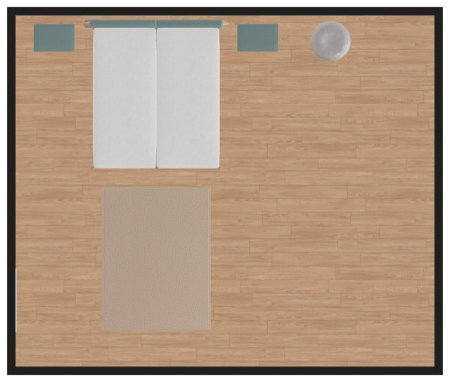
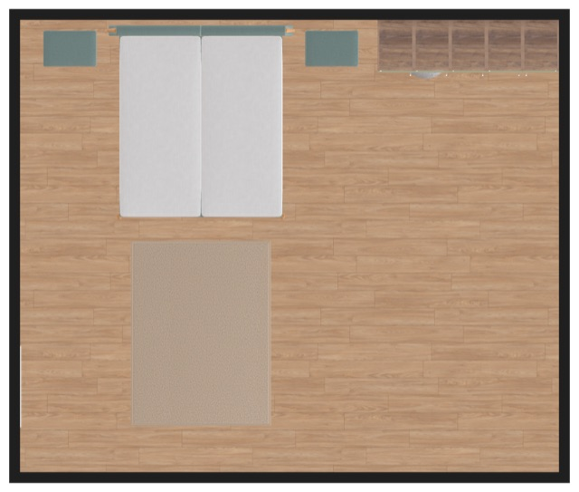

# Where no free stretch of the wall fits the group, it is placed over existing furniture

> **Type**: Bug analysis
> **Status**: Open
> **Date**: 2026-10-24
> **Base**: roomle-hi-example `master` (`26c3be1`); roomle-ui `feat/hi-mcp` (`c06518fe2`)
> **Backlog**: [mcp-issues.md #83](../backlog/mcp-issues.md#83-where-no-free-stretch-of-the-wall-fits-the-group-it-is-placed-over-existing-furniture-and-reported)

## Affected repositories

- **roomle-ui** (`feat/hi-mcp`) — the served Obstacles rule in `AUTHORING_RULES`
  (`homag-intelligence/src/hi-mcp/hi-mcp-server.ts:38`). It gets a sentence for a wall the user
  names whose free stretches are all narrower than the group, and the openings clause also covers
  other furniture. Also the unit test of the served text
  (`homag-intelligence/__tests__/hi-mcp/hi-mcp-server-test.ts`) and
  `.agents/homag-intelligence/hi-tools-behaviour.md`: the decision in §3, the D81 row, and the
  Obstacles item of §5.2.
- **roomle-hi-example** — this analysis, the mirror of the rule in
  [`hi-authoring-rules.md`](../skills/hi-authoring-rules.md) (Obstacles), a new test and the expect
  of `wardrobe-closets-back-wall` in [`docs/test-prompts.json`](../../docs/test-prompts.json), and
  the backlog item.
- **ligna-store** — unchanged. It gets the served text with the planner. The forwarding of
  `createHiMcpTools` does not change, so no new embedding-lib version is needed.

The tool commands, the placement and the `hint` stay as they are. No guard, no correction.

The roomle-ui paths are relative to `packages/web-sdk/packages/`. The D-numbers are the decisions in
§3 of
[roomle-ui `hi-tools-behaviour.md`](https://github.com/roomle-dev/roomle-ui/blob/master/.agents/homag-intelligence/hi-tools-behaviour.md#3-decisions).
The coordinates are in plan space: millimetres, `x` to the right, `y` to the top of the top-view
image.

## Symptom

The user names a wall, and the furniture there leaves no free stretch as wide as the group the
user asks for. The agent handles one request in two ways, from run to run:

- **It builds the group over the furniture and says so.** In `mcp-test-2026-10-20_06-45-46`,
  gpt-6-astra test 38, the prompt was "add a wardrobe of five cabinets with one door each, 400 mm
  wide each, to the back wall". The model put the five wardrobes (2000 mm) on the back wall over a
  low object (x 3506..4074, 568 × 570 mm), and the answer named the overlap. The run before,
  `mcp-test-2026-10-19_19-42-59`, did the same in tests 12, 34, 35, 36 and 39. In test 12, four
  wardrobes stood 240 mm over the bed and over the low object.
- **It asks first.** In tests 12, 37, 39 and 42 of the 2026-10-20 run, the requested rows were
  1200 to 2400 mm. The model asked whether to clear space or use another wall: "Nothing has been
  added yet."

Asking is allowed. The defect is that the served rules say nothing for this case. When the model
builds, it puts a wardrobe on top of a piece of furniture. The rules speak only of a group in front
of a door or a window. When the user leaves the width open, the model fits the wardrobes into the free
stretch: in `mcp-test-2026-10-21_12-49-36` test 06, "add two wardrobes to the back wall" gave two
550 mm wardrobes in the 1186 mm stretch at the right corner. Only a width the user gives leads to
the case without a free stretch.

The prompts of these tests now name the free right wall (`5ec7351`, 2026-10-20). No test in the
suite names a wall without a free stretch of the requested width. The run directories are no
longer on disk; the model behaviour above is taken from the backlog record.

### The closets back wall

The back wall is wall 5, 5945 mm long, from x -685 to 5260 at y 3765. Its `fromEndMm` counts from
x -685. What stands at it:

| Obstacle | Span along the wall | Height |
|---|---|---|
| The bed with its two night tables, one object, x -430..3050, y 1555..3705 | fromEndMm 255..3735 | 0..1170 mm |
| Window, x 320..2320 | fromEndMm 1005..3005 | 1300..2500 mm |
| Round pouf, x 3506..4074, y 3115..3685 | fromEndMm 4191..4759 | 0..399 mm |

A tall wardrobe (0..2200 mm, 617 mm deep) has three free stretches: 255 mm (fromEndMm 0..255),
456 mm (3735..4191) and 1186 mm (4759..5945, up to the right corner). A row of five 400 mm
wardrobes needs 2000 mm.

### Reproduction (model-free)

The payload of test 39 of `mcp-test-2026-10-21_12-49-36` (five `KS_HT600`, `mod_Width` 400, the
outer hinges) was replayed on the closets plan, with the placement on the back wall. The replay
ran on the planner of roomle-ui `feat/hi-mcp` (`c06518fe2`, an own dev server), through
`callExternalObjectAgentTool`. Script and output:
`.temp/result/repro-wall-without-a-free-stretch-2026-10-24/`.

1. `placement { wall: 'back' }` (centred, the wall alone): the row stands at x 1287.5..3287.5.
   All five root modules overlap the bed object, and three stand in front of the window.
2. `placement { wall: 'back', alignment: 'right' }` (from the longest free stretch, as in test 38):
   the row stands at x 3260..5260, and three root modules overlap the pouf.

   

   The `hint`, one sentence per root module:

   > Root module '…' (KS_HT600) of group '…' overlaps an object (x 3506 to 4074, y 3115 to 3685,
   > 0 to 399 mm) - free stretches of the back wall (wall 5) at its height: fromEndMm 3735 to 4191,
   > 4759 to 5945. […] The groups were built as sent - move or change them if the user did not ask
   > for them there.

The server builds the group in both cases and names every overlap, as D55 says. The difference
lies in what the agent sends and what it tells the user.

## Investigation trace

1. **The agent chooses the place before the call.** It uses the served rules and the `obstacles`
   of `get-plan-context`. The server does not move a group off an object: `place-group` and a
   placement by wall leave it where it is asked (D55, D81). Only a group that overlaps another
   group moves along the wall (G22). So the place is the agent's choice, and the served text
   decides it.
2. **The Obstacles rule has two cases** (`homag-intelligence/src/hi-mcp/hi-mcp-server.ts:38`):

   > A group goes where the user puts it - the wall, the corner or the spot the user names, also
   > when a door or a window is there: the result's hint names what it stands in front of, and your
   > answer says so. Where the user leaves the place open, choose a stretch of wall or a spot that
   > obstacles leaves free: […]

   "Add a wardrobe to the back wall" is half of each case. The user names the wall, so the first
   case puts the group on it. Where along the wall is left open, which is the second case. But the
   second case finds no free stretch as wide as the group. No sentence says what to do then.
3. **The first case speaks of doors and windows only.** "Also when a door or a window is there" and
   "your answer says so" cover openings. A bed or a pouf on the named wall is covered by neither
   sentence. A wardrobe in front of a window can be built. A wardrobe over a pouf cannot stand
   there unless the pouf goes, and the rules do not say whether the agent may plan it there.
4. **The placement form** (`hi-mcp-server.ts:35`) centres a group by default, and the server
   computes the point. Sent with the wall alone, the row lands over the bed and in front of the
   window (reproduction 1). The model in test 38 chose the corner with the longest free stretch
   (reproduction 2), which covers the least furniture. It made that choice without a rule.
5. **The hint comes after the choice** (`obstacleHint`, `homag-intelligence/src/hi-tool-hints.ts:520`;
   closing `hi-tool-commands.ts:765`). It names every root module on the pouf. It also lists the
   free stretches of the wall (`freeStretchesNote`, `hi-tool-hints.ts:409`), keeping those at least
   as wide as the *root module* (`freeStretchesAlongWall`, `hi-plan-space.ts:1092`). For a 400 mm
   wardrobe that is 456 and 1186 mm, but the 2000 mm row fits neither. The hint never says that no
   stretch fits the group. Its closing, "move or change them if the user did not ask for them
   there", does not decide the case either: the user did ask for the back wall.
6. **The decisions leave the server as it is.** D51: the tools do not restrict the agent. D55 and
   D81: the group is built where it is asked, and the hint names what it stands on. D22: never
   refuse what the user may want. A user may want the wardrobe on that wall and the pouf moved.
   The fix is an instruction (Guards Are a Last Resort, step 1).

## Root cause

`homag-intelligence/src/hi-mcp/hi-mcp-server.ts:38` (roomle-ui, `AUTHORING_RULES`, the Obstacles
rule). The rule has a case for a place the user names and a case for a place the user leaves open.
A wall the user names, with no free stretch as wide as the group, falls between them, and no
sentence covers it. The clause that lets a group stand on a named place and asks the answer to say
so covers doors and windows only, not other furniture. The model fills the gap with a guess, and
the guess changes from run to run: ask, or build over the furniture.

## Why the current code produces wrong results

- One request gives two behaviours, and neither is the specified one. A test cannot say which is
  right, and a user gets a question in one session and a wardrobe on a pouf in the next.
- The build puts a group over furniture, a case the rules do not mention. That test 38 told the
  user was the model's choice; no rule asks the answer to name furniture under a
  group. Item [#90](../backlog/mcp-issues.md#90-a-group-placed-over-existing-objects-is-not-disclosed)
  shows the same model dropping such an overlap when the place was left open.
- The expect of `wardrobe-closets-back-wall` (`docs/test-prompts.json:510-514`, "wall back,
  centred") describes reproduction 1: two wardrobes centred on the back wall stand over the bed and
  in front of the window. The expect contradicts the Obstacles rule on this plan. The model does
  better than the expect (test 06 above).

## Proposed fix

### Decision needed

What the agent does when the wall the user names has no free stretch as wide as the group. This is
a decision of the HI tools (a row in §3 of `hi-tools-behaviour.md`), so it is the user's.

**A — build on the named wall and say so (recommended).** The group goes on the wall the user
names, over as little furniture as it can. The answer names what it stands on and the alternatives:
another wall where it fits, narrower units. The reasons:

- It follows D81 (the group goes where the user puts it) and D51.
- The session preamble of the skills (`SKILL_IN_SESSION`, `hi-mcp-server.ts:80-87`) asks to "name
  the alternatives and the open checks in your answer".
- The hint's closing ("move or change them if the user did not ask for them there") already
  assumes this.
- The model already did this in six runs.
- The user sees the result in the plan and can undo it in one step.

**B — ask first.** The agent builds nothing and asks: that wall over the furniture, another wall,
or narrower units. This is the other half of today's behaviour, and a question is no MCP issue.
It is deterministic, but it costs the user a turn for a plan that a single undo would revert.

### roomle-ui (`feat/hi-mcp`)

1. **`homag-intelligence/src/hi-mcp/hi-mcp-server.ts:38`** — the Obstacles rule, decision A:
   - "also when a door or a window is there: the result's hint names what it stands in front of,
     and your answer says so" → "also when a door, a window or other furniture is there: the
     result's hint names what it stands in front of or on, and your answer says so".
   - After the free-stretch sentence ("…base units lower than a window's bottomMm fit below it."),
     one sentence: "Along the wall the user names, the same holds; when none of its free stretches
     is as wide as the group, put the group on that wall where it stands on the least, and your
     answer names what it stands on and the alternatives - another wall where it fits, narrower
     units."

   Decision B replaces the second sentence with: "When none of the free stretches of the wall the
   user names is as wide as the group, ask the user before building: that wall over what stands
   there, another wall where it fits, or narrower units."
2. **`homag-intelligence/__tests__/hi-mcp/hi-mcp-server-test.ts`**:
   - `it('tells the agent that a group goes on the wall the user names, also a wall of glass')`
     (`:1142`) asserts the changed first clause.
   - `it('tells the agent what stands in the room and that the hint names a root module on an obstacle')`
     (`:1162`) asserts the new sentence.
   - The served text stays free of rejections (§2.4).
3. **`.agents/homag-intelligence/hi-tools-behaviour.md`**:
   - The decision as a row of its own in §3 (D112), or as an extension of D81, whose row says "the
     free stretches are for a place the user leaves open".
   - The D81 row gets "or other furniture".
   - The Obstacles item of §5.2 gets the new sentence.
   - Item #83's tests and run in the guarded-by column.

### roomle-hi-example

- [`hi-authoring-rules.md`](../skills/hi-authoring-rules.md), Obstacles: the same two changes.
- [`docs/test-prompts.json`](../../docs/test-prompts.json), category closet:
  - A new test `wardrobe-back-wall-without-a-free-stretch`, closets plan, with the prompt "add a
    wardrobe of five cabinets with one door each, 400 mm wide each, to the back wall".
  - Its expect, for A: one `create-or-replace-groups` call with a placement on the back wall, five
    400 mm single-door wardrobes. No free stretch of the back wall is 2000 mm wide. The answer names
    what the wardrobe stands on or in front of (the low object, the bed, the window) and an
    alternative (the right wall). For B: no group is created, and the answer says that no free
    stretch of the back wall fits the 2000 mm wardrobe and asks.
  - The expect of `wardrobe-closets-back-wall` changes "wall back, centred" to "wall back, on a
    free stretch, or the answer names what it stands on".
- The backlog item: its responsible cell names roomle-ui `hi-mcp/hi-mcp-server.ts:38` and this
  analysis.

### Verification

- The unit tests of roomle-ui `homag-intelligence`.
- The new test and `wardrobe-closets-back-wall` with gpt-6-astra and the other models of the suite,
  on a planner that carries the change: the local roomle-ui dev server of `feat/hi-mcp`, or bo-test
  after a deployment. These are model runs, which start only on request.

## Alternatives rejected

- **Place the group where a stretch fits, on another wall** (the second half of the backlog
  item's to-do). This moves the group off the wall the user named, against D81. The other wall
  stays an alternative the answer names.
- **The server moves the group off the furniture along the wall**, as G22 does for another group.
  D55 and D81 keep the group where it is asked: the user may want it there. On this wall there is
  also no free position to move to, and G22 builds the group as asked in that case too.
- **A guard that refuses a group over an object.** Against D22, D51 and Guards Are a Last Resort.
  The server cannot tell a mistake from a wardrobe that replaces the pouf.
- **Narrower units than the user asked for.** The user gave the width. When the width is open, the
  model narrows the units already (test 06 above), and the free-stretch rule covers that.

## Out of scope

- **The hint's free stretches are per root module.** They are at least as wide as the root module
  (`freeStretchesAlongWall`, `hi-plan-space.ts:1092`). For a row they include stretches the row
  does not fit, and the hint never says that none fits the group. That did not cause this defect:
  the agent chooses before the call, and test 38 told the user. A sentence such as "no stretch of
  the back wall is as wide as the group (2000 mm)" would help an agent that moves the group
  afterwards. It is a separate item if wanted.
- **[#90](../backlog/mcp-issues.md#90-a-group-placed-over-existing-objects-is-not-disclosed)**,
  an island over objects when the place is left open, is about the same sentence but a different
  case. The first clause of the fix covers a place the user names, not a place left open.
- **The questions of tests 12, 37, 39 and 42** are no MCP issue in themselves. Here they show only
  the second behaviour.
