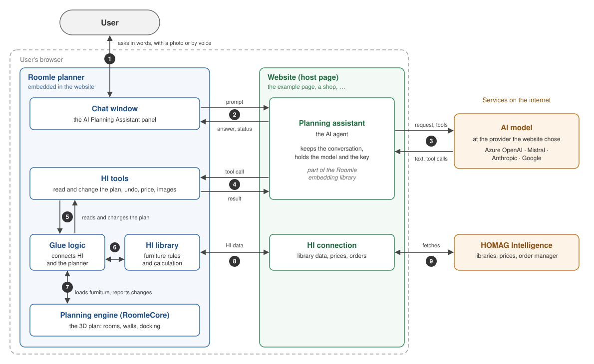

# How the AI Planning Assistant Works

The AI Planning Assistant is a chat window in the Roomle planner. In it, the user describes the
furniture they want — in words, with a photo or by voice — and an AI agent plans it in the live plan.
The furniture comes from a HOMAG Intelligence (HI) library: kitchens, wardrobes, living room and
utility furniture. The agent creates, changes, moves and deletes furniture groups, and answers
questions about the plan, the price and the order.

This page explains the parts of the assistant, where each one runs, and what happens when the user
sends a request. It is an overview for anyone who wants to understand, evaluate or integrate the
assistant. Developers find the technical details in the
[technical architecture](../.agents/context/agent-architecture.md).

## At a glance

- **It runs in the user's browser.** The assistant has no server of its own. Only the AI model and
  the HOMAG Intelligence services are reached over the internet.
- **The website chooses the AI model.** The website that embeds the planner decides which AI
  provider and model the assistant uses, and supplies the key for it.
- **The planner brings the chat window and the tools.** Every website that embeds the planner gets
  the same chat window and the same planning tools, and gets improvements to them with each planner
  update.
- **The agent plans like a person.** It uses the same HI rules, the same calculation, the same
  docking and the same undo as someone planning by hand in the planner.

## The components

| Component | Runs in | Role |
| --------- | ------- | ---- |
| **Chat window** | the planner | Shows the conversation. The user types, drops a photo or speaks, and the window shows the answer as it is written, plus what the agent is doing right now |
| **Website (host page)** | the browser | Embeds the planner, connects it to HOMAG Intelligence, and starts the planning assistant with the model it has chosen. Examples are the HI example page and a shop that embeds the planner |
| **Planning assistant** | the website | The AI agent, part of the Roomle embedding library. It keeps the conversation, sends each request to the AI model, and runs the tools the model asks for |
| **AI model** | the AI provider | Understands the request, decides which tools to use and writes the answer. Supported providers: Azure OpenAI, Mistral, Anthropic and Google |
| **HI tools** | the planner | The planning tools the agent can use (listed below) |
| **Glue logic** | the planner | Connects HOMAG Intelligence and the planner: it turns a tool's request into HI furniture groups, has the HI library calculate them, and keeps them in step with the plan. Manual HI planning in the planner uses it too |
| **HI library** | the planner | The furniture library of the manufacturer: its articles, their rules and their calculation. The planner loads it from HOMAG Intelligence when it starts |
| **Planning engine (RoomleCore)** | the planner | The 3D plan itself: rooms, walls, doors and windows, and how furniture docks to walls and to other furniture |
| **HOMAG Intelligence** | the internet | Provides the libraries, the prices and the order manager |

### How the components interact

The numbers match the diagram.

1. The user asks in the chat window and reads the answer there.
2. The chat window hands each request to the planning assistant, and the assistant sends the answer
   and its progress back to the window.
3. The planning assistant sends the conversation and the list of tools to the AI model. The model
   answers with text, with requests to use tools, or with both.
4. The planning assistant passes each tool request to the planner, where the HI tool runs, and
   returns the result to the model.
5. The HI tools read the plan through the glue logic and change it through the glue logic.
6. The glue logic has the HI library calculate every furniture group it builds or changes.
7. The glue logic loads the calculated furniture into the planning engine. The engine docks it and
   reports back when furniture has to adapt, for example to a wall.
8. The planner gets the HI library data, prices and orders through the website.
9. The website fetches them from HOMAG Intelligence.

The planner runs inside the website as an embedded frame, so steps 2, 4 and 8 are messages between
the website and the embedded planner. Inside the planner, the parts work together directly.

### The HI tools

The agent works with these kinds of tools:

- **Reading:** the rooms and walls, the furniture already in the plan, the article catalog, and a
  search for the attributes of the library, such as colours, materials and handles.
- **Planning guidance:** planning skills for a kitchen, a French kitchen, a living room and planning
  from a photo, and the rules for describing furniture groups.
- **Creating and changing:** create or replace furniture groups; move a group against a wall or into
  a corner; add, insert, exchange, swap or delete articles in a group; change attributes of an
  article or of a whole group; merge groups.
- **Interior fittings:** add, move, replace and delete shelves, drawers and other fittings inside
  cabinets.
- **Looking:** pictures of the plan (the furniture from the front and a view from the top), and
  opening the doors and drawers of a cabinet to look inside.
- **Undo and redo** of the agent's own changes.
- **Price and order data** for the current plan.

The agent never calculates positions itself. It describes where furniture goes: to the right of
another unit, on top of it, against a wall, in a corner. The planner works out the exact positions
with the same rules it uses when someone plans by hand.

## What happens when the user sends a request

Take the request "Plan a kitchen along the left wall":

1. **The request leaves the chat window.** The window shows the message, marks the assistant as
   working, and hands the request to the planning assistant in the website.
2. **The model reads the request.** The planning assistant sends the AI model the instructions, the
   conversation so far, the new request and the list of tools.
3. **The model asks for information.** It typically fetches the kitchen planning skill first, then
   the plan: the rooms, the walls, the furniture already there and the catalog. Each tool request
   goes to the planner and the result comes back to the model. The chat window shows which tool is
   running.
4. **The model plans.** It asks the planner to create a group of cabinets against the left wall,
   naming the articles and how they stand next to each other.
5. **The planner builds the kitchen.** The tool checks the request and corrects small mistakes, such
   as an article number written in the wrong case. The glue logic has the HI library calculate the furniture, and the
   planning engine places it against the wall and docks the units to each other. The whole change
   becomes one step of the planner's undo history.
6. **The result goes back to the model.** It contains what was built, what was corrected and what
   could not be built. The model may look at pictures of the plan, adjust things, or add more
   furniture, one tool after another.
7. **The model answers.** It summarises what it changed. The text appears in the chat window while
   it is written, and the window is ready for the next request.

A request takes at most 16 model steps, and the last step always answers the user. A question about
the plan takes a few seconds. A whole kitchen planned from a photo takes one to two minutes.

If something goes wrong — the model is not reachable, or the request is aborted — the chat window
shows an error. Whatever the tools changed until then stays in the plan, and the undo button of the
planner takes it back.

## Why it is built this way

- **The plan stays where the user works.** The tools work on the live plan in the user's browser,
  so the user sees every change at once and can keep planning by hand at any time.
- **The website owns the AI decision.** Which provider, which model and which contract apply is the
  decision of the company that runs the website, not of the planner.
- **Tools improve with the planner.** The tools ship with the planner, so a better tool reaches every
  website without changes to the website.
- **One set of rules.** Because the agent only describes relations and the planner does the
  placement, a plan made by the agent follows exactly the same HI rules as a plan made by hand.
- **Changes can be undone.** Each change the agent makes is one undo step. The agent can undo its
  own last changes, and the user can use the planner's undo button.

## Security and privacy

- **The key is in the page.** The planning assistant calls the AI model directly from the browser
  with the key the website supplies. Anyone who can inspect the page can read that key, and the AI
  provider must accept calls from a browser.
- **Plan data goes to the AI provider.** The rooms, the furniture, the prices and the pictures of the
  plan go to the provider the website chose. Whether that is acceptable for a customer-facing
  website is a decision to take before going live.
- **Only the assistant in the page can use the tools.** There is no access point for outside AI
  applications. The tools follow the shape of MCP (Model Context Protocol) tools, but there is no
  MCP server, and an application such as Claude Desktop cannot control the planner.

## Limits

- One request at a time: the chat window accepts the next request when the current one is answered.
- The browser tab has to stay open while the assistant works.
- The conversation lasts as long as the page: reloading the page starts a new conversation. The plan
  itself is not affected.
- Photos can be sent only when the chosen AI model reads images. Voice input needs a browser with
  speech recognition, such as Chrome, Edge or Safari.

## Further reading

- [User guide](user-guide/README.md): how to use the HI agent, with example prompts and limits.
- [The AI chat in the example](ai-chat.md): running the example page with a model.
- [Technical architecture](../.agents/context/agent-architecture.md): every component and every step
  in detail, for developers.
